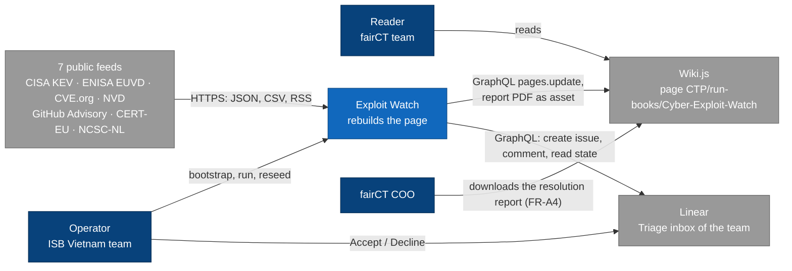
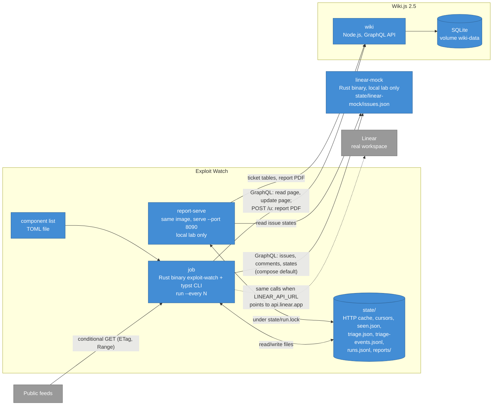
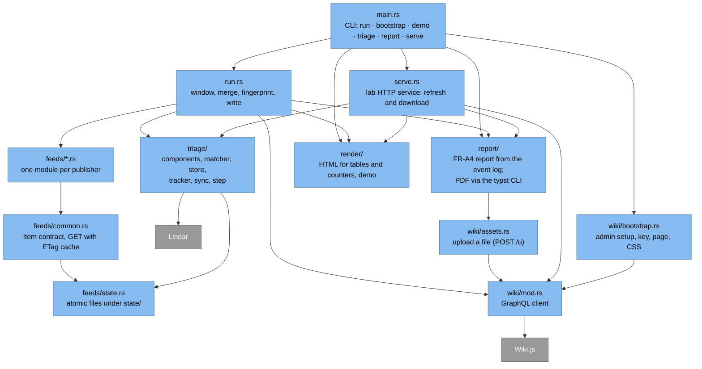
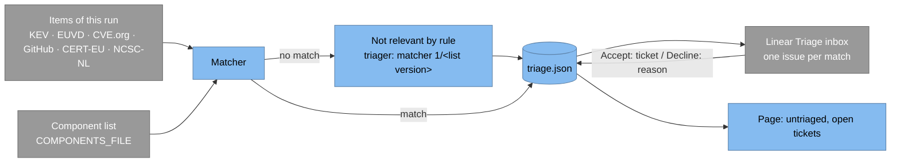

# Cyber Threat Exploit Watch

Rebuilds the Wiki.js page `CTP/run-books/Cyber-Exploit-Watch` from free public vulnerability and advisory feeds, so the page always shows the last 7 days.

`Lab prototype` · `Local Docker Compose only` · `As of 2026-11-05`

## Contents

- [Overview](#overview)
- [Status and roadmap](#status-and-roadmap)
- [Getting started](#getting-started)
- [Architecture](#architecture)
- [How a run works](#how-a-run-works)
- [Feeds](#feeds)
- [Triage](#triage)
- [Resolution report (FR-A4)](#resolution-report-fr-a4)
- [Operations](#operations)
- [Configuration](#configuration)
- [State](#state)
- [Known limitations](#known-limitations)
- [Development](#development)
- [Decisions](#decisions)

## Overview

fairCT is the EU bond Consolidated Tape Provider built by Ediphy. Its DORA milestone MS-30 ("Cyber threat dashboard") has one intake requirement, FR-A1:

> Ingest threat feeds from free, credible sources (CERT-EU, ENISA, CISA KEV, NCSC, NVD/CVE, MISP/CIRCL OSINT) into one dashboard. New items appear within 1 hour of publication; source and timestamp shown for each item.

This repository is a fork of Mark McKee's prototype `mckema/cyber-dashboard` (2026-10-17), which refreshed the page weekly from three feeds with a Python script. The fork:

- reads seven feeds: the FR-A1 sources except MISP/CIRCL OSINT, which Mark McKee dropped on 2026-11-03, plus GitHub Advisory;
- is a single Rust binary, `exploit-watch`;
- runs against a self-hosted Wiki.js 2.5 in Docker Compose for testing. The production page is on `wiki2.internal.ediphy.io` behind Google Cloud IAP and is not written by this fork yet.

The job also covers the next two MS-30 requirements, FR-A2 (triage every new item: relevant to fairCT or not, with a reason and who decided, within one business day) and FR-A3 (a ticket for each relevant item): it matches items against a component list, files one Linear issue per match and shows the untriaged items and open tickets on the page. See [Triage](#triage).

FR-A4 (an internal resolution report to the fairCT COO, monthly and on demand) is built from the job's append-only triage event log: a PDF for a calendar month, and a month-to-date PDF linked from the page. See [Resolution report (FR-A4)](#resolution-report-fr-a4).

The job only replaces content inside anchored elements of the page (table bodies, counters, a stamp). Prose on the page stays hand-editable.

## Status and roadmap

Where each environment stands is in [Deployment](#deployment); decisions behind the plan are in [Decisions](#decisions).

| Item | Requirement | Status (2026-11-05) |
|---|---|---|
| Replace the sample component list with a test list from colleagues (Rust and UI libraries), then the list agreed with Germano | FR-A2 | Waiting for the list |
| Run `live` against a personal Linear Free workspace, then ask Mark McKee for a sandbox team in Ediphy's Linear | FR-A2, FR-A3, FR-A9 | Personal workspace done on 2026-11-04/05 (18 API and UI checks); sandbox team not requested yet |
| Monthly and on-demand report to the fairCT COO | FR-A4 | Built in the local lab on 2026-11-05: `report --month` command, month-to-date PDF linked from the page and from `report-serve`. Since 2026-11-06 each month is closed automatically (final PDF frozen and uploaded, review reminder in Linear with a quality-check sample). Where the COO reads it, who reviews it, and the retention period, not agreed yet |
| Run the lab loop against the Linear test workspace instead of `linear-mock` | FR-A2, FR-A3 | Since 2026-11-06 with `compose.linear-test.yml` (see [Operations](#operations)) |
| Cloud Run Job, Cloud Scheduler, GCS state, Terraform; write to `wiki2` via IAP | — | Deferred |

## Getting started

Requirements: Docker Desktop with Compose v2. No Rust toolchain is needed. Behind the corporate proxy, set `HTTP_PROXY` and `HTTPS_PROXY` on the host; Compose passes them to the build and the job.

```bash
docker compose up -d --wait wiki
docker compose run --rm job bootstrap        # once: admin, API key, page; writes .env
docker compose run --rm job run --dry-run    # fetch and diff, write nothing
docker compose up -d                         # start the job loop
```

The page is at http://localhost:3000/en/CTP/run-books/Cyber-Exploit-Watch. Run commands from the repository root (Git Bash on Windows). Every `docker compose run --rm job …` also starts `linear-mock` (the job waits for it to be healthy), so its image is built on first use.

## Architecture

Diagrams follow the [C4 model](https://c4model.com). Level 4 (code) is not drawn; [Deployment](#deployment) takes its place.



*Level 1, System Context.*



*Level 2, Container.*



*Level 3, Component (inside the job; modules under `stack/job/src/`).*

### Deployment

| Environment | Runtime | Wiki | Status (2026-11-05) |
|---|---|---|---|
| Local lab | Docker Compose: `wiki` + `job` + `linear-mock` + `report-serve`, loop every 21600 s (6 h); tracker `live` against `linear-mock`, or since 2026-11-06 against the Linear test workspace with `compose.linear-test.yml` | Wiki.js 2.5.317, page id 1 | Running (against the Linear test workspace since 2026-11-06) |
| Production | Cloud Scheduler + Cloud Run Job, state in GCS | `wiki2.internal.ediphy.io` via IAP, page id 51 | Decided, not built |
| Production, FR-A4 monthly report | A second Cloud Scheduler trigger on the 1st at 06:00 Europe/Amsterdam runs the job image as a Cloud Run Job with `report --close-month` (the previous month; the 6-hourly runs close it as well if that trigger failed), with `EW_ENVIRONMENT=production`; report.json, report.pdf, SHA256SUMS, frozen.json and review.json go to a GCS bucket with a retention policy and Bucket Lock (WORM, like S3 Object Lock in compliance mode; locked only once the retention period is agreed); the PDF is shared with the COO from a Google Shared Drive as a link, not as an email attachment | — | Proposed by the ISB Vietnam team (2026-11-06), not built; where the COO reads it is not agreed |
| Production, FR-A4 on demand | The month-to-date PDF uploaded by each run (as in the lab). The "Generate current report" and "Sync with Linear" buttons would need a Cloud Run service behind IAP that verifies the IAP JWT (`x-goog-iap-jwt-assertion`) and logs who asked, shows a confirm page on GET and refreshes on POST (`Sec-Fetch-Site: same-origin`), and takes a GCS lock (object create with `ifGenerationMatch=0` and a lease) instead of `flock` | — | Proposed, not built |

## How a run works

1. Take the lock `state/run.lock`, so only one run uses `state/` at a time. If another run holds it, stop; a loop run waits for it first (see the table below).
2. Set the window to the last 7 days (UTC).
3. Call each feed module in order. A module whose `CADENCE` has not elapsed reuses the items of its last successful fetch (`state/items/`).
4. Merge: CISA KEV and ENISA EUVD rows join by CVE into one "exploited" table; NVD scores fill CVE.org records that have no CNA or CISA-ADP score; CERT-EU and NCSC-NL share one advisory table.
5. Triage (see [Triage](#triage)): match every item against the component list, record new decisions in `triage.json`, and, on a writing run only, sync the tracker. Then, on a writing run, build the month-to-date resolution report and upload its PDF to the wiki when its content changed or the last upload is 24 hours old (see [Resolution report (FR-A4)](#resolution-report-fr-a4)); a report or upload error is recorded and does not stop the run. Since 2026-11-06 a writing run then closes the previous month if it is not closed yet (see Monthly close in [Resolution report (FR-A4)](#resolution-report-fr-a4)); an error there is recorded as `close_month` and does not stop the run either.
6. Render seven tables (feed health, exploited, advisories, dependencies, CVEs, untriaged, open tickets), the counters and the four Linear tiles, and splice them into the current page by anchor id. The feed health table ends with a "Linear" row for the tracker (see [Triage](#triage)).
7. Fingerprint the data, leaving out regions that change every run (health table, health count, window label, the "as of" time next to "Sync with Linear"), but including each feed's status, the Linear row's status, the content sha of the month-to-date PDF the page links to, and the PDF sha and review issue of the latest monthly report. Write only when the fingerprint changed, when `HEARTBEAT_HOURS` (24 h) has passed since the last write, or when the page no longer carries the current data (after a reseed or a manual edit).
8. Write with one `pages.update` call. `scriptCss` is never sent by the job.
9. Record each item's first-seen time in `seen.json` and one line in `runs.jsonl`.

| Condition | Result |
|---|---|
| CISA KEV or CVE.org cvelistV5 fails (the `CORE` feeds) | `FATAL`, nothing written, exit 1 |
| Any other feed fails after an earlier success | Last good items reused, health row "Stale", page written, exit 0 |
| Any other feed fails with no earlier success | Health row "Error", its table empty |
| A feed module panics | Treated as that feed failing (`internal error: panic: …`) |
| Every feed returns nothing | Refuses to publish, exit 1 |
| A page anchor is missing | `page anchor … not found — re-seed the page skeleton`, exit 1 |
| No data change, heartbeat not due | `skipping write`, no new page version |
| `FATAL` while looping (`--every`) | Logged and recorded as `fatal`; next run proceeds |
| Component list does not load, or `triage.json` is unreadable | Triage skipped; the triage tables say why; feed tables written as usual |
| Tracker call fails | An error of one item (`INPUT_ERROR`, unexpected reply) skips that item; any other error stops issue creates and comments for this run. Issue states are read back in both cases, progress so far is saved, errors go to `runs.jsonl` under `triage.errors` and the first one to the Linear row of the health table; page written |
| Another run holds `state/run.lock` (for example a manual `docker compose run --rm job run` while the loop's run is in progress) | A single run prints `LOCKED: another run holds …`, records one `locked` line in `runs.jsonl`, writes nothing else and exits 75. A loop run (since 2026-11-05) tries again every minute for up to `LOCK_WAIT_SECONDS` (15 minutes), then records `locked` and waits for its next interval |

## Feeds

| Source | Endpoint and method | Cadence | Timestamp shown |
|---|---|---|---|
| CISA KEV | `cisa.gov` catalog; on failure the GitHub mirror `cisagov/kev-data` with `If-None-Match` | every run | date |
| ENISA EUVD | `/api/search?fromKEVDate&toKEVDate` (exploited entries only); if that query fails (other than HTTP 429), `/api/search?exploited=true` read in full and filtered by `exploitedSince` (since 2026-11-06) | every run | date |
| CVE.org cvelistV5 | Range read of `deltaLog.json` (`Accept-Encoding: identity`), then each changed record; first run backfills from daily zips | every run | second, UTC |
| NVD API 2.0 | `lastModStartDate` from the cursor minus 15 min; scores only, merged into CVE.org rows | 2 h | — |
| GitHub Advisory | `type=reviewed`, `published=<date>..<date>`, follows `Link: rel="next"` | every run | second, UTC |
| CERT-EU | RSS every run; JSON per advisory only when new or changed | every run | second, UTC |
| NCSC-NL | `changes.csv` with ETag; CSAF document only when new or changed | every run | second, UTC |

Measured on 2026-11-03 at the earlier 30-minute interval: a normal run made about 10–40 requests, most answered `304 Not Modified`. The first cvelistV5 backfill took 105 requests and 46.7 MB.

## Triage

FR-A2 asks for every new item to be triaged within one business day, with a reason and who decided; FR-A3 asks for a ticket with owner, due date and status for each relevant item. Mark McKee approved this flow on 2026-11-03; the same Linear ticket also serves FR-A9 for now.



- **Matcher** (`stack/job/src/triage/matcher.rs`, rule version 1), first rule that fits:
  1. `package`: GitHub advisory ecosystem and package equal a library component.
  2. `cpe`: a CVE.org CPE starts with a component's CPE 2.3 prefix.
  3. `vendor-product`: normalised product (and vendor, if the component lists vendors) from KEV, EUVD or CVE.org equals a component.
  4. `cve-join`: an advisory or other item whose CVE's CVE.org record matches by rules 1–3.

  Affected versions are not checked, so a match is a candidate. An item that matches nothing is recorded as not relevant, with `matcher <rule version>/<component list version>` as the triager.
- **Component list**: TOML, one `[[component]]` per entry (`id`, `kind` = library | image | infra, `ecosystem`, `names`, optional `vendors` and `cpe`). `stack/job/components.sample.toml` is a sample of 17 entries for testing; the real list is to be agreed with Germano (date not stated).
- **Store**: `state/triage.json` keeps one record per new item key with the decision, a copy of the item (so an issue can be filed after the item leaves the 7-day window), the issue and its last known state. Records older than 30 days are dropped once closed, declined with a reason, or not relevant. Every change is also appended to `state/triage-events.jsonl` (see [State](#state)), which keeps the history after the record is dropped; each `decided` event carries the component list version and the sha256 of its file, so a "not relevant by rule" decision can be traced to the exact list it was made with.
- **Tracker** (`LINEAR_MODE`): `off` (default of the binary) records decisions but files nothing; `live` calls a Linear GraphQL endpoint (`issueCreate` in the team's triage state, `commentCreate` when the item changes, issue states read back each run). The endpoint is `LINEAR_API_URL`, by default `https://api.linear.app/graphql`; compose points it at the `linear-mock` service, so the same HTTP client runs end to end without a Linear workspace. Since 2026-11-06 the tracker can also file an issue that is not an item (`create_task`, used for the monthly review reminder) in the team's first workflow state of a given type, with the same idempotent id.
- **Issue ids**: before the first `issueCreate` for a record, the job saves a random UUID v4 in `triage.json` (`issue_create_id`) and sends it as `IssueCreateInput.id` on every attempt. Linear refuses a second insert with the same id (HTTP 200, `INPUT_ERROR` "conflict on insert of Issue") and creates nothing, so when the answer to a create is lost, the next run reads the existing issue with `issue(id:)` and records it ("already existed" on stdout and, in a run without errors, on the Linear row of the health table; `recovered` in `runs.jsonl`). If the id is taken but Linear no longer returns its issue (deleted), the record gets a new id and the issue is filed once more. Linear accepts version 4 ids only; a name-based (v5) id was refused on 2026-11-05.
- **Read-back**: each run reads every issue's state with one `issues` query per 25 issues, including the 50 newest history entries and comments of each issue. Linear state types map to `triage` → untriaged, `backlog`/`unstarted`/`started` → accepted, `completed` → done, `duplicate` → declined, and `canceled` → declined or canceled. Since 2026-11-05 the job tells a Decline from a cancel after Accept: on the Linear test workspace a Decline set `canceledAt` within 3–4 ms of `triagedAt`, while an issue accepted one day and canceled the next had `canceledAt` about 20 hours after `triagedAt` and two history entries (Triage → Backlog, then Backlog → Canceled). So `canceled` with `canceledAt` more than 5 seconds after `triagedAt` is `canceled` (closed, no reason asked, dropped after 30 days like done), otherwise `declined`; without `canceledAt`, the history entry that left Triage decides (to backlog, unstarted, started or completed: canceled). `actor` and `changed` record who triaged the issue and when: `changed` is Linear's `triagedAt`, set by any move out of Triage (Accept, Decline, a status change, Mark as duplicate); `actor` is the name on the history entry within 5 seconds of `triagedAt`, otherwise on the newest entry that left Triage. Later moves, for example by the OAuth app, do not change them. The decline reason is the latest comment the job did not write, written no earlier than 5 seconds before `triagedAt` (a comment from while the issue was still in Triage is no reason); its time is kept as `reason_at`. An issue marked as duplicate without such a comment gets the reason `Marked as duplicate`. The query also reads `createdAt`, `startedAt`, `completedAt` and `canceledAt` into `created`, `started`, `completed` and `canceled` (UTC); records read back before 2026-11-05 lack them until the next read-back. A job image from before this change cannot load a `triage.json` that holds the state `canceled`, so roll back together with that file.
- **Tracker errors** (since 2026-11-05; `stack/job/src/triage/sync.rs`): no tracker error fails the run, and each is recorded. An error of one item or issue (GraphQL `INPUT_ERROR`, an unexpected reply, an id still taken after its retry) skips that item, and the run goes on with the next create or comment. An error that every further call would hit as well (no answer, HTTP error, rate limit, `AUTHENTICATION_ERROR`, `FORBIDDEN`, `INPUT_ERROR` "Entity not found: Team", a settings error, or a GraphQL error with another code) stops creates and comments for this run, because each call can wait up to the 90-second HTTP timeout. In both cases the run still reads every known issue's state back once, so accepts and declines in Linear reach the page while a create keeps failing. Skipped items are tried again next run. Before 2026-11-05 the first error of any kind ended the round, read-back included.
- **Linear row**: the feed health table ends with a "Linear" row: `OK` with the counts of the run (created, already existed, commented, updated) and the number of issues the store tracks; `Error` with the first error of the run (cut to 300 characters) and how many more there were; `Off` when `LINEAR_MODE=off`; `Error` "not configured" when the settings are invalid. A `--dry-run` or `--out` run in live mode calls no tracker and shows no Linear row. The row is not a feed: it is left out of the feed count above the table, the refresh bar and the `feeds` record in `runs.jsonl`. The row's status (`ok`, `error`, `off`) is part of the fingerprint, so a run where Linear goes from ok to error, or back, rewrites the page at once; a new error text or new counts under the same status wait for the next write (data change or the 24-hour heartbeat). The error is in `runs.jsonl` and on stdout at once.
- **Supported triage actions**: the flow approved by Mark McKee on 2026-11-03 is Accept (relevant; set an owner and a due date) and Decline (not relevant; give the reason as a comment), then the ticket's status until it is closed. Mark as duplicate is read as a decline. Snooze, Archive and Delete are not part of the flow and get no special handling (see [Known limitations](#known-limitations)).
- **linear-mock** (`stack/linear-mock/`, local lab only): answers six operations (`TriageState`, `StateByType`, `IssueCreate`, `IssueById`, `CommentCreate`, `IssueStates`) with the shapes a real Linear workspace returned on 2026-11-04/05 and keeps issues in `state/linear-mock/issues.json`. To simulate triage, edit an issue's `state` (`accepted`, `declined`, `done`, `duplicate`, or `accepted-canceled` for a ticket accepted and later canceled) with `assignee`, `due` (YYYY-MM-DD), `reason`, `actor` (who triaged it) and optionally `changed` (when), and save; the next run reads it back. The mock returns history and comments newest first, sets `triagedAt` and writes one history entry for leaving Triage (with no states for `duplicate`); `accepted-canceled` gets two entries (Triage → Backlog at `changed`, Backlog → Canceled at `canceledAt`). Since 2026-11-05 it also returns `createdAt` (from `created`), `completedAt` for `done` (optional `completed`, else `changed`), and `canceledAt` for `declined` and `duplicate` (optional `canceled`, else `changed`, as Linear sets it at the Decline) and for `accepted-canceled` (optional `canceled`, else one hour after `changed`); `startedAt` is always null. `IssueCreate` keeps a client `id` (UUID v4) as the issue id and answers a repeated id with Linear's "conflict on insert of Issue" error. As a failure switch, an `IssueCreate` whose title contains `FAIL-CREATE` gets an `INPUT_ERROR` ("linear-mock: create refused") and creates nothing. Since 2026-11-06 `StateByType` returns a Todo state (`state-todo`, type `unstarted`) and `IssueCreate` accepts it, keeping `assigneeId` and `dueDate` when given; such an issue has the state `todo` in `issues.json` and is never in Triage (no `triagedAt`, no history). Rate limits, pagination, other moves after the triage, Snooze and other operations are not simulated.
- **Page**: since 2026-11-06 the Linear part comes first on the page, under the heading "Triage and actions (Linear)", followed by the group "Threat feeds — last 7 days" (the five feed tiles, then feed health, exploited, advisories, packages and CVEs as subsections), the feed descriptions and the terminal examples. The page shows one number per concept, and each label states its scope (now, this month or the last 7 days). Since 2026-11-06 the masthead reads "Cyber Threat Exploit Watch" (the prototype's "Weekly Exploit Watch" named its weekly refresh, replaced by the 6-hour cycle on 2026-11-03), and the line above it says "rolling seven days · updated every 6 hours": the 7-day window is what the feed tables show, the 6 hours how often they are refreshed. That line is static text in the skeleton; change it with `INTERVAL_SECONDS`. Since 2026-11-06 the "Updated" line (region `f-status`, volatile like the window label; since 2026-11-06 without the feeds summary, which the Feed health header shows, and without the CISA KEV catalog version) heads "Threat feeds — last 7 days" and the top bar holds the report card only; the report buttons show a download icon (CSS mask on class `dl`) and save as `cyber-threat-report-YYYY-MM.pdf` or `cyber-threat-report-YYYY-MM-to-date.pdf`; "Sync with Linear" (formerly "Refresh tickets") pulls the latest ticket status. A full-width 1 px rule separates the four top-level parts (Linear, threat feeds, feed descriptions, terminal examples), each a full-width band with its own `wrap`; the masthead title is a `div` with `role="heading"`, not an `h1`, and the feed descriptions and the footer use `h4`, so Wiki.js's two-level table of contents lists the subsections of the first two parts only. The Linear heading carries on its right a "Sync with Linear" button (lab only, when `SERVE_PUBLIC_URL` is set) and the tickets' "as of" time in Amsterdam time (CET or CEST). Under it are four tiles (`l-kpis`). "Waiting for triage" (now) counts the rows of the untriaged table, with how many are overdue and how many need a reason; "Open tickets" (now) counts the rows of the open-tickets table, with how many are overdue, have no owner or have no due date. Both link to their table, are red when one of these counts is not zero and green when nothing is pending. "Triaged this month" is the report's `funnel.assessed` (the PDF's "assessed"), with how many were triaged within 1 business day; "Closed this month" is `outcomes.fixed_count` plus `outcomes.closed_without_fix`, split into fixed and without fix. The "now" tiles come from the same view of `triage.json` as the tables, so they always agree with them; the month tiles come from the month-to-date report (`report.json`), so they agree with the PDF. Earlier on 2026-11-06 a summary line showed the report's month figures above the tables, which count other sets (the lab page showed "Waiting 4 (4 overdue)" above a table header of 6). A run without a new month-to-date report (`--dry-run`, `--out`, report error) uses the last `state/reports/month-to-date/report.json`; without one, the month tiles show "—" with "no month-to-date report yet". The untriaged table lists matched items with no decision in Linear, and issues declined without a reason (FR-A2 asks for one), with the note "declined in Linear without a reason" under the issue; such a row stays until a reason is added as a comment in Linear. A row turns red after one business day from first sight, counted Monday to Friday in Europe/Amsterdam time with no holiday calendar. The open-tickets table lists accepted issues with owner, due date (red when past) and state; a missing owner or due date is shown in red as "no owner" or "no due date" and counted in the table header. Only a writing run (not `--dry-run` or `--out`) files issues or saves `triage.json`.

Local test on 2026-11-04 with the sample list over the 7-day window, against `linear-mock`: 3,383 items, 2 matched (`clickhouse` and `vite`, rule `vendor-product`), 3,381 not relevant by rule; two issues filed (`MOCK-1`, `MOCK-2`), one accepted and one declined by editing `state/linear-mock/issues.json`, and the next run showed one open ticket and no untriaged item. With a wrong `LINEAR_API_KEY` the run still wrote the page and recorded the authentication error in `runs.jsonl`.

## Resolution report (FR-A4)

FR-A4 asks for an "internal resolution report to the fairCT COO: items triaged, actions taken, actions open", generated on demand and monthly, with no external sharing. Mark McKee described it on 2026-10-30 as a monthly report covering resolved issues and open ones with plans. Design chosen by the ISB Vietnam team on 2026-11-05: the wiki page stays the dashboard, the monthly report is a PDF, and the on-demand report is a month-to-date PDF linked from the page. Readers see it as the "Cyber threat report" (after MS-30, "Cyber threat dashboard"), on the page and as the PDF's title.

- **Source**: `state/triage-events.jsonl` (see [State](#state)) and `state/runs.jsonl`, not `triage.json`, which forgets after 30 days. Events are placed at the time Linear gives (`triagedAt`, `completedAt`, `canceledAt`, and for a decline reason the time the comment was written), not when the job logged them; repeated event ids count once; a half-written last line is skipped; a ticket's state is the one logged last (a reopened ticket carries its triage time, earlier than the cancel it undoes). Since 2026-11-05 each `decided` event also carries `score` (CVSS base, or null), `severity`, `exploited` and `exploited_source`; for older events the report takes these from the item copy in `triage.json` when the record is still there, in memory only (the log is never rewritten). The report takes no lock.
- **Period**: a calendar month in Europe/Amsterdam time (`report --month YYYY-MM`), or the current month to now. A period that ends before the event log starts (its first line) is refused; one that starts before it carries a "history covers from" note. In the lab the log starts on 2026-11-05 (against the Linear test workspace, on 2026-11-06).
- **Layout** (Henry, 2026-11-06; replaces the layout of 2026-11-05; English, PDF/A-2b, A4; audience the fairCT COO first, audit second). One template and one build path for the monthly report and the month-to-date snapshot; they differ only in the title suffix, the document status, and the quality-check sample and review reminder of a closed month. Each fact appears once, in about 3 pages. Every page has a header with the short title and the document ID on the left and the data marking and TLP on the right, the marking as a watermark, and a footer with TLP and the page number. Page 1, the summary: the title ("Cyber threat report — `<Month YYYY>`", for a snapshot followed by ", month to date (1–`<d> <Mon>`)") and one line with the document status, document ID, period and tickets as of; when the event log starts after the period start, a partial-history notice; the overall status (GREEN, AMBER or RED, as text and colour) with a bottom line of two sentences that says why the status has its colour and what is needed, without repeating the key figures; the key figures; and "Decisions and attention", one line per kind of point with its count and ticket ids (overdue action on a known-exploited vulnerability, not assessed after 1 business day, overdue action, open action without owner or due date, sources failing or stale, no scheduled run, tracker errors), "None." when there is none. Page 2, the month in review: intake and assessment as the funnel diagram of 2026-11-05 (new public notices → automatically ruled out → relevant to fairCT → assessed → action planned / ruled out by a person / waiting), with the per-source split and the median and maximum time to assess and the items assessed after more than 1 business day under it, the action backlog (open at the start of the month + accepted + reopened − fixed − closed without fix = open at the end, from the event log; a ticket accepted and closed between two read-backs counts as accepted), the open actions (overdue first, with owner, due date, status, age in days since first seen, exploited and severity, and a mark for items first seen in an earlier month), one table "Resolved in the month" (fixed, closed without fix and ruled out by a person, with who, the reason or the due date, and the date; a line above it splits actions closed from items ruled out, because the dashboard's "Closed this month" counts actions only), and the items waiting for assessment, flagged when over 1 or 3 business days or declined without a reason. Appendix (on its own page, Henry 2026-11-06): the quality-check sample (closed month only), feed health of the last scheduled run, ticket tracker errors, short definitions, and one table for provenance and document control. `report.json` carries the new sections as `backlog`, `waiting_items`, `kpis[].trend`, grouped `attention` (`group`, `count`, `items`, `text`) and `resolved[].kind`/`by`/`detail`/`date`; `exceptions` stays in the JSON and is no longer printed.
- **Vocabulary** (PDF; JSON keys stay technical): matched = "relevant to fairCT"; not relevant by rule = "automatically ruled out"; triaged = "assessed"; accepted = "action planned"; declined with a reason = "ruled out by a person"; declined without a reason = "ruled out without a reason", counted as waiting (since 2026-11-06); canceled after acceptance = "closed without fix"; done = "fixed". Headings carry no requirement ids; the appendix names FR-A4 once.
- **Assessed and waiting** (Henry, 2026-11-06; one definition on the page and in the PDF): a relevant item is waiting at the cut-off while it is still in Triage, has not been read back yet, or was declined in Linear without a reason (FR-A2 asks for one; the page's untriaged table already lists such issues). It is assessed when accepted, at `triagedAt`, or declined with a reason, at the later of `triagedAt` and the time the reason comment was written. `funnel.waiting` counts the waiting items first seen in the period, `funnel.waiting_without_reason` those of them declined without a reason. The reason's time is `reason_at` of the `field_changed` event for the reason (logged since 2026-11-06); an event without it takes `triagedAt` when the same read-back logged the decline and the reason, otherwise the time of the read-back that first saw the reason. Until 2026-11-06 the report counted a decline without a reason as assessed and ruled out by a person at the decline time, and listed it only as an exception.
- **Key figures**: relevant to fairCT; assessed within 1 business day (items relevant in the period, assessed within 24 Amsterdam business hours, out of those assessed plus those waiting longer, declines without a reason included; target 100%); open actions, of which overdue (target 0 overdue); fixed by due date (target at least 95%, a team proposal pending agreement, marked as such under the table; "—" without fixes; NIST SP 800-40r4, Table 1 is cited only for the definitions of the metrics remediation by due date and time to remediate); known-exploited items still open (target 0 overdue); sources healthy in the last scheduled run (ok or cached; target all). Each key figure is shown with the previous calendar month and a trend (▲, ▼ or =, the direction of the number; "—" when the event log does not cover the previous month); a month-to-date snapshot shows the previous value as a reference and "partial month" instead of a trend, and a previous month the event log covers only in part shows its values under "Previous month (partial)" without a trend (Henry, 2026-11-06).
- **Known exploited**: the item comes from CISA KEV or ENISA EUVD (every item of those feeds; on a merged row CISA wins), or it is a CVE.org record whose CISA ADP SSVC "Exploitation" is `active` (`poc` does not count): `triage::store::exploited_source`, written into each `decided` event. The report also marks an item exploited when one of its CVEs was logged from CISA KEV or ENISA EUVD by the end of the period.
- **Overall status** (team proposal, 2026-11-05; `status: {rag, reasons}` in `report.json`, the worst rule that fires). GREEN: every relevant item assessed within 1 business day, no overdue action, every open action with owner and due date, all sources healthy in the last run, no tracker error in the period. AMBER, any of: an assessment took more than 1 business day, or a relevant item (a decline without a reason included) has waited that long; an open action without owner or due date; a source stale or failing in the last run, or no scheduled run in the period; a tracker error in the period; an overdue action on an item not known to be exploited; fewer than 95% of the period's fixes by their due date. RED, any of: an overdue action on a known-exploited item; a relevant item waiting (not assessed, or declined without a reason) for more than 3 business days at the end of the period; CISA KEV or CVE.org failing for more than 2 days (a fatal run counts as a failure of the core feed its error names). Until 2026-11-06 a decline without a reason was AMBER as soon as it happened; since then it follows the same clock as any other waiting item. The 95% rule is an addition to the approved list so that every key figure's status counts; the known-exploited figure is red only when such an item is overdue.
- **Provenance and document control** (appendix, one table since 2026-11-06): document ID `EW-CTR-<YYYY-MM>` or `EW-CTR-<YYYY-MM>-MTD-<YYYYMMDD-HHMM>` (the cut-off), version 1.0 and status ("Final monthly", "Interim (period not over)" or "Snapshot"), prepared by "Exploit Watch job, operated by the ISB Vietnam team", distribution "fairCT COO; others on a need-to-know basis (TLP:AMBER+STRICT)", retention "to be agreed with fairCT", period, generated, tickets as of, history coverage, component list and sha256, tracker endpoint, scheduled runs by result, data sha256 (with `SHA256SUMS` next to the file), source files, and for a closed month the review reminder issue when `review.json` names it (`report.json` `review_issue`). The "Reviewed by" and "Acknowledged by the fairCT COO" signature lines were removed on 2026-11-06: the review is reminder-only.
- **Marking**: the header and footer of every page carry `TLP:AMBER+STRICT` (FIRST TLP 2.0: amber on black, 11 pt; internal to fairCT, no further sharing). Since 2026-11-06 a data marking follows `EW_ENVIRONMENT` (`lab`, `test` or `production`, default `lab`): outside production every page carries `LAB DATA` when the tracker endpoint is `linear-mock`, else `TEST DATA`, as a tag in the header and a watermark (since 2026-11-06 no notice box on page 1, and no longer in the footer or the provenance table; `marking.notice` stays in `report.json`); production carries none. A test run of the monthly close (`--now`) is marked at least `TEST DATA`. `report.json` holds it as `marking` (`label`, `notice`, `environment`, `test_run`), replacing `tracker.lab_data`.
- **Output**: `state/reports/<YYYY-MM | month-to-date>/` with `report.json`, `report.pdf` and `SHA256SUMS` (`sha256sum -c` format). `data_sha` (printed in the appendix) is the sha256 of `report.json` without `generated_at`; `content_sha` covers only the content sections (`components`, `status`, `bottom_line`, `attention`, `kpis`, `open_actions`, `resolved`, `outcomes`, `funnel`, `backlog`, `waiting_items`, `exceptions`), so it does not change with the hour alone; ages in whole days and the "over 1 business day" flags change it at most once a day.
- **On demand, from the page** (option B): each writing run builds the month-to-date report and uploads the PDF as the wiki asset `/exploit-watch/cyber-threat-report-to-date.pdf` when `content_sha` changed or the last upload is 24 hours old (`state/reports/month-to-date/upload.json`). Under the page's status strip (feeds with a coloured dot, last update, KEV catalog), a "Cyber threat report" card says what the report covers and, since 2026-11-06, has two buttons. "Monthly report · `<Month YYYY>`" links to the latest frozen monthly PDF (tooltip "Final, frozen on `<d Mon YYYY>`"), with a small "Review: `<issue>`" link to the review reminder issue; before the first monthly report the card says "First monthly report: 1 `<Mon YYYY>`" instead. "Generate current report" links to `SERVE_PUBLIC_URL/report/month-to-date.pdf` (tooltip "Month to date, fresh from Linear. Not the monthly report.") or, when `SERVE_PUBLIC_URL` is not set, to the uploaded asset with `?v=<content sha>` and its "Current report data as of" time. The card does not say "official": the monthly report is final (frozen), not approved. Wiki.js serves the asset with `Content-Disposition: attachment`. Until 2026-11-06 the card had the buttons "Download report (PDF)" and "Refresh data & download".
- **On demand, refreshed on click** (option 3b, local lab only): served by `report-serve` (see [Operations](#operations)). "Generate current report" (`GET /report/month-to-date.pdf`) and, since 2026-11-06, "Sync with Linear" (`GET /refresh`) read every issue back from the tracker, build the month-to-date report with tickets as of the click, upload it like option B, and rewrite the Linear section of the page: the two ticket tables, their counters, the four tiles and the "as of" time; when the report fails, the month tiles and the "as of" time come from the last `report.json` (the stamp and the other tables stay as the last run left them; the page is written only when they changed). The first returns the PDF; the second sends the browser back to the page (`303` to `WIKI_PUBLIC_URL`). Measured on 2026-11-05 against `linear-mock`: 1.5 s; a click during a run waited 12 s for the lock.
- **Monthly close** (since 2026-11-06; `stack/job/src/report/close.rs`): once a month is over (Europe/Amsterdam), the job freezes its final report, uploads the PDF and files a review reminder in Linear. The same function runs in two places: every writing `run`, right after the month-to-date report, closes the previous month if it is not closed yet (catch-up; the result is the `close_month` entry in `runs.jsonl` and never fails the run), and `report --close-month [--month YYYY-MM]` does it by hand (default: the previous month). Steps: (1) skip with a reason when the month is not over or the event log does not cover it, and skip the freeze when `reports/<YYYY-MM>/frozen.json` exists; (2) draw the quality-check sample, build the month's report with status "Final monthly" and the sample in its appendix, append `report_frozen` and `sample_drawn` to the event log and write `frozen.json`; from then on `report --month <YYYY-MM>` refuses to overwrite the folder; (3) upload the PDF as the wiki asset `/exploit-watch/cyber-threat-report-YYYY-MM.pdf` and record it in `upload.json`; (4) file the review reminder and log `review_issue_created`. A step that failed (wiki or Linear unreachable) is retried by the next call without rebuilding the frozen report; a call after success changes nothing. For MS-30 the PDF is shared with the COO by hand.
- **Review reminder**: one Linear issue per month, "Review monthly cyber threat report — `<Month YYYY>`" (with "[TEST] " in front for a test run), created in the team's first workflow state of type `unstarted` (Todo), not in Triage. Its description links the dashboard (`WIKI_PUBLIC_URL`) and the PDF (absolute when `WIKI_PUBLIC_URL` gives the wiki's origin, else the asset path), and has a checklist: check the figures and exceptions, download the PDF, send it to the fairCT COO via the Shared Drive, close the issue. It then lists the quality-check sample as a checklist "Really not relevant?" with a link per item and asks the reviewer to comment on the issue when an item is relevant. Assignee (`REPORT_REVIEW_ASSIGNEE_ID`) and due date (`REPORT_REVIEW_DUE_DAYS` business days after the month's last day) are sent only when set; both stay unset until agreed with Mark McKee. The issue is created idempotently like item issues: a UUID v4 is saved in `review.json` before the first attempt and sent as `IssueCreateInput.id`, and a "conflict on insert of Issue" answer is resolved by reading the issue with `issue(id:)`. The reminder is only a reminder (Henry, 2026-11-06): the job does not read it back, records no reviewer or approval, writes nothing into `triage.json`, and the PDF carries no review stamp. With `LINEAR_MODE=off` no reminder is filed.
- **Quality-check sample** (a control for the automatic rule-out, which matches by component name only and does not check affected versions): `REVIEW_SAMPLE_SIZE` (default 10) of the month's `decided` events with the decision not relevant by rule; all of them when there are fewer, and the note "No automatically ruled-out items in the period." when there are none. The draw is deterministic: the seed is the sha256 of the month and the sorted candidate keys (one per line), and the keys with the lowest sha256(seed + key) are taken, so a rerun or an auditor gets the same list from the event log. Each item carries its title, vendor / product and source link from `triage.json` while the record is there, otherwise the title and link of its `decided` event, otherwise a link built from the key. The sample is printed in the monthly PDF's appendix ("Quality check sample — automatically ruled-out items"; not in month-to-date reports), saved in `review.json` and listed in the review reminder.
- **Card data**: `report::latest_monthly()` returns the newest frozen month whose PDF is on the wiki (month, title, asset path, PDF sha256, frozen time, review issue). The PDF sha256 and the review issue are part of the page fingerprint, so a new monthly PDF or reminder rewrites the page.

## Operations

```bash
docker compose ps
docker compose logs -f job
docker compose run --rm job run                          # one run now
docker compose run --rm job run --out state/out.html     # render with live data, no write
docker compose run --rm job bootstrap --update-css       # after editing stack/wiki/page/style.css
docker compose run --rm job bootstrap --reseed --update-css && docker compose run --rm job run
                                                         # after editing stack/wiki/page/skeleton.html
docker compose run --rm job bootstrap --purge-history P7D   # drop page versions older than 7 days (all pages)
docker compose build job                                 # after any change under stack/job/src/
docker compose run --rm job triage --report              # match counts over state/items/, no network
docker compose build linear-mock                         # after any change under stack/linear-mock/src/
docker compose logs linear-mock                          # one line per GraphQL call from the job
docker compose run --rm job report --month 2026-11       # FR-A4 monthly report -> state/reports/2026-11/
docker compose run --rm job report --month-to-date       # month to date -> state/reports/month-to-date/ (no upload)
docker compose run --rm job report --close-month                  # close the previous month: freeze, upload the PDF, file the review reminder
docker compose run --rm job report --close-month --month 2026-11  # a given month
MSYS_NO_PATHCONV=1 docker compose run --rm -e STATE_DIR=/app/state/<copy> job report --close-month --now 2026-12-01T06:00:00Z
                                                         # test the close on a copy of state/
curl -OJ http://localhost:8090/report/month-to-date.pdf  # what the page's "Generate current report" button does
curl -i http://localhost:8090/refresh                    # "Sync with Linear": refresh, then 303 to the page
docker compose logs report-serve                         # one line per request
tail -5 state/runs.jsonl
```

**Against the Linear test workspace** (since 2026-11-06): `compose.linear-test.yml` points `job` and `report-serve` at `https://api.linear.app/graphql` with the OAuth app token, uses its own state (`state/linear-test/state`) and component list (`state/components.linear-test.toml`), and sets `EW_ENVIRONMENT=test`. The token and team id come from `state/linear-test/secrets.env` (gitignored), never from `.env`, so a loop started without the overlay cannot send a real key with `linear-mock`'s `triage.json`. Set these three variables in the shell for every `docker compose` call; unset `COMPOSE_FILE` and `COMPOSE_ENV_FILES` to go back to `linear-mock`. The wiki page is shared: whichever setup wrote last is what the page shows.

```bash
export COMPOSE_PATH_SEPARATOR=:                                  # Windows defaults to ";"
export COMPOSE_FILE=compose.yml:compose.linear-test.yml
export COMPOSE_ENV_FILES=.env,state/linear-test/secrets.env
docker compose up -d
```

`report --close-month` takes the run lock (waiting up to `LOCK_WAIT_SECONDS`). It exits 0 when the month was closed or nothing was left to do, 1 when the upload or the reminder failed (run it again; it resumes), and 75 when the lock stayed busy. `--now` is for tests only: it acts as if it were that moment, marks the report at least `TEST DATA` and puts `[TEST] ` in front of the reminder title. Use it on a copy of `state/`, because the month it closes stays frozen.

`report-serve` (local lab only) runs the job image as `exploit-watch serve --port 8090` on `127.0.0.1:8090`: `GET /healthz` answers `ok` (its compose healthcheck is `serve --healthcheck`); `GET /report/month-to-date.pdf` refreshes the tickets and returns the PDF. `GET /refresh` (since 2026-11-06) does the same refresh and answers `303 See Other` with `Location: WIKI_PUBLIC_URL` (200 "Refreshed. Go back to the page." when it is not set); within the cooldown, which both routes share, it redirects without refreshing; when the lock stays busy it answers 503 with `Retry-After`; on an error, 500. Within `SERVE_COOLDOWN_SECONDS` (60) of the last refresh it returns the last PDF; it waits up to `SERVE_LOCK_WAIT_SECONDS` (90) for a run that holds `state/run.lock`, and returns the last PDF if the lock stays busy (503 with `Retry-After` when there is none yet). Response headers `X-Report-Refreshed`, `X-Report-Reason` (cooldown, locked, error) and `X-Report-As-Of` say what was served. Each request on either route adds a `mode: "serve"` line with its `route` to `runs.jsonl`. After a code change, `docker compose build job` and `docker compose up -d` recreate both `job` and `report-serve`. `bootstrap` (since 2026-11-05) also grants the bot key `read:assets` and `write:assets` on the `exploit-watch` asset folder and creates that folder; run it once after upgrading.

`bootstrap` is idempotent: a second run keeps the existing key (`bootstrap ok (.env unchanged)`). After `docker compose down -v` the wiki's admin and key are gone; run `bootstrap` again to recreate them.

Only one `run` uses `state/` at a time. A manual `docker compose run --rm job run` started while the loop's run is in progress prints `LOCKED: …`, records `locked` in `runs.jsonl` and exits 75 without doing anything; run it again once `docker compose logs job` shows the loop's run has finished. If the loop's run starts while a manual run or a `report-serve` refresh holds the lock, the loop tries again every minute for up to `LOCK_WAIT_SECONDS` (15 minutes) before it skips to its next interval (6 hours).

## Configuration

Read from `.env` (created by `bootstrap` from `.env.example`) and the environment. Compose overrides `WIKI_BASE` and `STATE_DIR` for the job, and supplies `LINEAR_*` defaults that point at `linear-mock` when `.env` leaves them empty.

| Variable | Default | Used for |
|---|---|---|
| `WIKI_BASE` | `https://wiki2.internal.ediphy.io` (compose: `http://wiki:3000`) | Wiki.js URL |
| `WIKI_PAGE_ID` | `51` (local bootstrap writes `1`) | Page to update |
| `WIKIJS_API_KEY` | — | Bot key, sent as `Authorization` |
| `IAP_ID_TOKEN` | — | Google OIDC token, sent as `Proxy-Authorization` (behind IAP only) |
| `WIKI_ADMIN_EMAIL`, `WIKI_ADMIN_PASSWORD` | `admin@example.com`, generated | Local admin, used by `bootstrap` only |
| `STATE_DIR` | `./state` | Job state |
| `INTERVAL_SECONDS` | `21600` | Seconds between runs in the compose loop |
| `HEARTBEAT_HOURS` | `24` | Rewrite the page after this long without a data change |
| `CVE_ROW_CAP` | `300` | Rows shown in the CVE table |
| `GITHUB_TOKEN` | — | Raises the GitHub API limit from 60 to 5,000 requests/h |
| `NVD_API_KEY` | — | Removes the 6 s pause between NVD pages |
| `USER_AGENT` | built-in | User-Agent for feed requests; CERT-EU rejects requests without one |
| `COMPONENTS_FILE` | `stack/job/components.sample.toml` | Component list for the matcher |
| `LINEAR_MODE` | `off` (compose: `live`) | Tracker: `off` or `live` |
| `LINEAR_API_URL` | `https://api.linear.app/graphql` (compose: `http://linear-mock:8080/graphql`) | Linear GraphQL endpoint |
| `LINEAR_API_KEY` | — (compose: `lin_api_mock`) | Live mode only. A Linear personal API key (prefix `lin_api_`, sent as `Authorization: <key>`) or an OAuth access token, e.g. from an OAuth app's `client_credentials` grant (prefix `lin_oauth_`, sent as `Authorization: Bearer <token>`). Never written to logs, errors or the page |
| `LINEAR_TEAM_ID` | — (compose: `mock-team`) | Live mode only: the team whose Triage inbox receives issues |
| `LOCK_WAIT_SECONDS` | `900` | Loop (`--every`) and `report --close-month`: how long a run waits for `state/run.lock` held by another run |
| `EW_ENVIRONMENT` | `lab` | Data marking of report PDFs: `production` none; otherwise `LAB DATA` against `linear-mock`, else `TEST DATA` (since 2026-11-06) |
| `REVIEW_SAMPLE_SIZE` | `10` | Monthly close: automatically ruled-out items sampled for the review (`0` turns the sample off) |
| `REPORT_REVIEW_ASSIGNEE_ID` | — | Monthly review reminder: Linear user id of the assignee; unset until agreed with Mark McKee |
| `REPORT_REVIEW_DUE_DAYS` | — | Monthly review reminder: due this many business days (Monday to Friday, Amsterdam) after the month's last day; unset until agreed with Mark McKee |
| `WIKI_PUBLIC_URL` | — (compose: `http://localhost:3000/en/CTP/run-books/Cyber-Exploit-Watch`) | The page as the browser sees it: `report-serve` sends the browser back there after "Sync with Linear", and the monthly review reminder links the dashboard and, from its origin, the PDF (`WIKI_BASE` is the wiki URL between containers) |
| `TYPST_BIN` | `typst` (in the image: `/usr/local/bin/typst`, version 0.15.1) | typst CLI used to render report PDFs |
| `SERVE_PUBLIC_URL` | — (compose: `http://localhost:8090`) | URL of `report-serve` as the browser sees it; when set, the report card's "Generate current report" and the Linear section's "Sync with Linear" link to it |
| `SERVE_COOLDOWN_SECONDS` | `60` | `report-serve`: no new refresh this soon after the last one |
| `SERVE_LOCK_WAIT_SECONDS` | `90` | `report-serve`: how long a click waits for a run to release the lock |
| `MOCK_APP_TOKEN` (`linear-mock` only) | — (compose: `lin_oauth_mock`) | OAuth access token the mock accepts as `Authorization: Bearer <token>` besides `MOCK_API_KEY`; must differ from `MOCK_API_KEY` and must not start with `lin_api_`. Set `LINEAR_API_KEY=lin_oauth_mock` in `.env` to exercise the job's Bearer path against the mock |

Do not put `$` or quotes in `.env` values: Compose reads the file too.

## State

`state/` is gitignored, owned by uid 1000 (the job's user), and was about 16 MB on 2026-11-03.

| Path | Content |
|---|---|
| `http/` | Conditional-GET cache: ETag and body of the last `200` |
| `items/<module>.json` | Items of each feed's last successful fetch |
| `cursors/` | Per-feed cursors: cvelistV5 `fetchTime`, NVD and CVE stores, CERT-EU and NCSC-NL caches |
| `seen.json` | Item key → first-seen time, kept 30 days |
| `wiki.json` | Data fingerprint and time of the last write |
| `triage.json` | One record per new item: decision, item copy, issue create id (`issue_create_id`), issue and its last read state (`issue_status`: `state` = `triage`, `accepted`, `done`, `declined` or `canceled`, `state_name`, `assignee`, `due`, `reason`, `reason_at`, `actor` = who triaged it, `changed` = when it left Triage, and since 2026-11-05 `created`, `started`, `completed`, `canceled` from Linear). The working set: records are dropped 30 days after first sight once finished |
| `triage-events.jsonl` | Since 2026-11-05: every change to `triage.json` as one JSON line (`decided`, `issue_created`, `triaged`, `state_changed`, `field_changed`, `pruned`), each with a stable `id`, `key`, `at` (when it happened) and `ts` (when it was logged). Appended by writing runs only and never pruned; the source for the FR-A4 report and the audit trail. The first writing run after the upgrade writes a `baseline` of every record held at that time, dated from the record (the decision at first sight, triage and closing at the times Linear gave, owner, due date and reason at the record's last change), so history before 2026-11-05 covers only records still in `triage.json` then. About 3 MB a month with the sample list (estimate). Since 2026-11-06 the monthly close also appends `report_frozen`, `sample_drawn` and `review_issue_created` with the key `report:YYYY-MM`; the report ignores them. Since 2026-11-06 a `field_changed` event for the reason also carries `reason_at` (when the comment was written; empty for a duplicate without a comment) |
| `reports/<YYYY-MM \| month-to-date>/` | Since 2026-11-05: FR-A4 report as `report.json` (times in Amsterdam local time, `as_of` in UTC), `report.pdf` and `SHA256SUMS`; `month-to-date/upload.json` records the last PDF uploaded to the wiki (path, `content_sha`, time). Since 2026-11-06 a closed month also has `frozen.json` (`frozen_at`, `data_sha`, `pdf_sha`, `content_sha`, `marking`, `document_id`, `test_run`; its presence means the folder is final and is not overwritten), `upload.json` (wiki asset path, `pdf_sha`, upload time) and `review.json` (the quality-check sample, the reminder's `create_id` and its issue). See [Resolution report (FR-A4)](#resolution-report-fr-a4) |
| `linear-mock/issues.json` | Issues held by the `linear-mock` service; editable by hand to simulate triage |
| `run.lock` | Lock held by the run in progress (advisory `flock`); while held it contains that run's pid, container hostname and start time, otherwise it is empty. Do not delete it |
| `runs.jsonl` | One line per run: `result` (`written`, `unchanged`, `would-write`, `out`, `locked`, `fatal`, `crash`), per-feed `status`, `items`, `new`, `baseline`, `lag_max_min`, `lag_median_min`, and `triage` (`components` version and `components_sha256` of the list file, `mode`, `endpoint` in live mode, `new_matched`, `new_not_relevant`, `created`, `recovered`, `commented`, `updated`, `pruned`, `missing_owner`, `missing_due`, `missing_reason`, `missing_actor`, `errors`: one line per tracker error of the run), and on a writing run `report` (`label`, `content_sha`, `data_sha`, `pdf_sha`, `uploaded`, `upload_error`, or `error`). Lines with `mode: "serve"` come from `report-serve`: `result` (`refreshed`, `cooldown`, `locked`, `error`), `seconds`, `updated`, `page_written`, `error`, and since 2026-11-06 `route` (`/report/month-to-date.pdf` or `/refresh`). Writing runs since 2026-11-06 also carry `close_month` (month, and either the reason it was skipped or what was done: `frozen`, `uploaded`, `review`, `events`, errors); `report --close-month` adds a line with `mode: "close-month"` |

Lag is an item's first-seen time minus its first publication time (`published`; a later `updated` time is ignored), in minutes. It is recorded for items new on a run whose publication time has a time of day, and not on a feed's first (baseline) run. It is a metric, not a pass/fail rule (Mark McKee, 2026-11-03).

`missing_owner` and `missing_due` count open tickets without an assignee or a due date; `missing_reason` counts matched items declined without a reason; `missing_actor` counts matched items out of Triage with no name for who triaged them. Since 2026-11-05 a read-back that comes back without `actor` or `changed` for an issue still out of Triage keeps the earlier values. They are counted from `triage.json` on every run, also when no tracker call is made, for the FR-A4 monthly report.

Every `run` takes the lock, including `--dry-run`, `--out` and each `--every` iteration, because all of them write feed caches, cursors and `runs.jsonl`; only the wiki write is skipped. `bootstrap`, `demo` and `triage --report` do not write `state/` and do not take the lock; `report` writes only `state/reports/` and takes no lock; `report-serve` takes the lock for each refresh. The lock is released when a run ends in any way, including a panic or `docker compose kill`, so it never needs to be cleared by hand.

Reset only what you need: deleting `http/` forces full downloads; deleting `cursors/cvelist*` forces a 7-day backfill (about 47 MB); deleting `seen.json` makes the next run a baseline with no lag measured. If a root container created files in `state/`, the job cannot write them; fix with `MSYS_NO_PATHCONV=1 docker run --rm -v "$(pwd -W):/app" debian:trixie-slim chown -R 1000:1000 /app/state`.

## Known limitations

Found by testing against Wiki.js 2.5.317 and the live feeds on 2026-11-03.

**Job**

- The run lock is an advisory `flock` on `state/run.lock`. It works across containers on one Docker host, including Docker Desktop's Windows bind mount (verified 2026-11-04), but not across hosts or on object storage; the production design (Cloud Run Job, state in GCS) needs a different lock, for example a GCS object created with an `ifGenerationMatch=0` precondition (not built).

**Wiki.js**

- The HTML sanitiser strips `<style>`, `<script>` and `<link>` and mangles long inline `style` attributes, so the page has no JavaScript and no inline styles.
- `pages.single` checks `manage:pages`, not `read:pages`. The bot key's group has `read:pages`/`write:pages` on `CTP/run-books/` and `manage:pages` on this page only.
- A wrong key does not return 401: an unknown key reads as guest (HTTP 200, "not authorized"); a revoked key or a disabled API returns HTTP 500.
- An admin `pages.update` without `scriptCss` clears the page CSS; `bootstrap` always resends it. The bot key has no `write:styles`, so job writes keep it.
- Every update creates a page version (about 330 KB each). Old versions are removed only by `bootstrap --purge-history`, as admin.
- `pages.create` reports a misleading "not authorized to delete" message on refusal; only its error code is reliable.
- Behind the corporate proxy the local wiki cannot fetch its locale files, so its chrome shows raw keys such as `header.search`. The page is not affected.
- The sanitiser keeps `title`, `tabindex`, `role`, `aria-label`, `<details>`/`<summary>` and `<button>` (checked on 2026-11-06 with a scratch page on the lab wiki). Since then long section descriptions are cut to one line followed by an "ⓘ" tooltip (`<span class="tip" tabindex="0" title="…">`, CSS only, shown on hover and on keyboard focus); the full text is also in `title`, so the browser shows its own tooltip as well.
- Since 2026-11-06 the long tables (exploited, advisories, dependencies, CVEs, untriaged, open tickets) scroll inside a frame (`div.tscroll`, at most 640 px or 75 % of the window) with a sticky header row; the count above each table says how many rows there are. Feed health does not scroll.
- Since 2026-11-06 the page skeleton has new anchors (`l-kpis`, which replaced `l-summary` the same day, and `l-refresh`): a job built from this version fails on a page seeded earlier ("page anchor … not found") until `bootstrap --reseed --update-css` has run.

**Feeds**

- `cisa.gov` returns 403 through the corporate proxy; KEV is read from the GitHub mirror, which trailed catalog releases by 1.1–4.4 h (8 releases, 2026-10-21..30).
- NVD scores few new CVEs: a severity filter returned 156 of 3,371 CVEs over 7 days. NVD is used for scores only.
- The GitHub API allows 60 unauthenticated requests per hour per IP, shared by everyone behind the proxy; `304` responses still count.
- CERT-EU's RSS dates carry a "CEST" label; the job uses the per-advisory JSON time (UTC). Whether the label changes to "CET" in winter is not verified.
- Some NCSC-NL documents have only a CVSS 4.0 vector in a note; those items show no score. NCSC-NL titles are in Dutch.
- The CVE table shows the first 300 rows by score (`CVE_ROW_CAP`).
- Items with a date only (KEV, EUVD) have no measurable lag.
- The EUVD query parameter `fromKEVDate` appears in no published ENISA API documentation (checked 2026-11-06). If that query fails (other than HTTP 429, which leaves the feed stale rather than send more requests), the job reads all exploited entries with `/api/search?exploited=true` (1,786 entries, 18 requests, about 5.4 MB and 27 s on 2026-11-06) and keeps those whose `exploitedSince` falls in the window; the EUVD row of the health table then names the fallback and the error. Both queries use `/api/search`, so a change to that endpoint itself still leaves EUVD stale until the code is updated.
- `/api/exploitedvulnerabilities` is not used as a fallback: on 2026-11-06 it ignored paging parameters and returned a fixed list of 4 entries, one fewer than `/api/search` returned for the same 7 days.

**Triage**

- The matcher does not check affected versions; every match needs a person to confirm it in Linear.
- Items cached before 2026-11-04 lack the `products`, `cpes` and `eco_packages` fields the matcher reads until they are fetched again (for CVE.org: delete `state/cursors/cvelist*`).
- The business-day clock has no holiday calendar.
- Linear does not require an owner and a due date on Accept, or a comment on Decline. The job only flags these gaps on the page and counts them in `runs.jsonl`; it does not block triage or write to Linear. Whether to make them mandatory is pending with Mark McKee.
- Linear behaviour the code relies on was checked against a personal Linear Free workspace (EU region) on 2026-11-04/05: a wrong or revoked key gives HTTP 401 with `AUTHENTICATION_ERROR`; history and comments come back newest first and `first: N` keeps the N newest; Mark as duplicate uses its own state type `duplicate` (not `canceled`) and writes a history entry without states; an OAuth app appears as a user in `actor`, not in `botActor`. `linear-mock` follows these results; a passing local run does not prove other Linear behaviour.
- Who triaged an issue is found only while that history entry is among the issue's 50 newest; after more changes `actor` is empty, while `changed` (from `triagedAt`) stays correct.
- Snooze keeps an issue in Triage, so a snoozed item stays untriaged and turns red after one business day; whether Snooze counts as triage is to be decided with Mark McKee.
- Archive is not handled: an issue archived in Linear keeps the state it had, so one archived while still in Triage stays in the untriaged table. The job still reads it (`includeArchived: true`). Linear's UI offers no Archive action for an issue in Triage.
- The decline reason is the latest comment the job did not write, so a comment added after a decline replaces it. The issue a duplicate points to is not recorded.
- Moving an issue back to Triage and out again is not tested; `triagedAt` may keep the first triage time.
- Issue ids are random and kept in `state/triage.json`; if that file is lost or restored from an older copy after an issue was created, the next run can file a second issue for the same item. Linear refused a name-based (v5) id, which would have survived this.
- If an issue is deleted in Linear before the job has recorded it (its create answer was lost), the job files a new issue under a new id. Whether Linear frees a deleted issue's id, and whether `issue(id:)` returns archived or trashed issues, is not verified.
- The path that sends `IssueCreateInput.id` from the job has run against `linear-mock` and in unit tests; on the real workspace only a hand-made create with a fixed id was tested (2026-11-05), because no new item matched the test component list after the change.
- A wrong `LINEAR_TEAM_ID`, or a key not scoped to that team, gets HTTP 200 with `INPUT_ERROR` "Entity not found: Team" from Linear, not `FORBIDDEN`; the error on the Linear row of the health table names both causes, and the run stops creating issues at the first one, as for `FORBIDDEN`.
- Issue references in `state/triage.json` belong to one tracker. Before pointing `LINEAR_API_URL` at another endpoint (mock to real Linear or back), or when resetting `state/linear-mock/`, move `state/triage.json` aside too. Otherwise a comment on an issue the endpoint does not have fails on every run until that item leaves the 7-day window, and the issue keeps its last known state. Before 2026-11-05 the first such error also stopped the read-back of every other issue.
- A hand edit to `state/linear-mock/issues.json` reaches the page on the next writing run: within 6 hours in the loop, or now with `docker compose run --rm job run`. Put a decline reason in `reason`; `comments` holds the job's own comments.
- The job does not obtain or refresh OAuth tokens. A `client_credentials` access token lasts 30 days; after that every Linear call fails with `AUTHENTICATION_ERROR` (shown on the Linear row of the health table and in `runs.jsonl`; the run itself does not fail) until `LINEAR_API_KEY` is replaced with a new token.
- `linear-mock` checks only the header form of the OAuth token; it does not simulate token issuance, expiry, revocation or scopes.

**Resolution report (FR-A4)**

- History starts with the event log. Records still in `triage.json` at that moment enter it as a dated `baseline`, but a record pruned earlier, or a change made between two read-backs (for example accepted and done within one 6-hour cycle), leaves no trace; Linear itself keeps the full history. In the lab the log starts on 2026-11-05, so October 2026 has no report.
- Owner, due date and status come from the job's read-backs, so a month-end report shows the last values the job read before the end of the month (at most 6 hours old in the loop).
- The business-hours clock has no holiday calendar, as on the dashboard.
- Where the COO reads the report, how long reports and the event log are kept, and the marking (TLP:AMBER+STRICT for now) are not agreed with Mark McKee yet. Since 2026-11-06 the monthly PDF is uploaded as the wiki asset `cyber-threat-report-YYYY-MM.pdf`, with the same exposure as the month-to-date PDF.
- The catch-up in `run` closes only the previous month; a month missed for longer must be closed with `report --close-month --month YYYY-MM`.
- A month is frozen as of its close. A later read-back that dates a change inside that month is not in its final report, and reports are not reissued.
- The review reminder is not read back: whether the report was reviewed or sent is visible only in Linear. Since 2026-11-06 the PDF has no signature lines, and the review reminder's issue appears in the appendix only when `review.json` already names it when the report is built; the close files the reminder after the freeze, so a first freeze does not show it (the dashboard's card and Linear do).
- The action backlog counts what the event log shows: a change between two read-backs that leaves no trace is not in it, and anything it cannot classify (for example a ticket moved back to Triage) is shown as "other".
- Since 2026-11-06 a reason counts only once a read-back has seen it: a report cut between the comment and the next read-back (at most 6 hours in the loop) still shows the item as waiting. For reason events logged before 2026-11-06 (no `reason_at`), the reason's time is `triagedAt` when the same read-back logged the decline and the reason, otherwise that read-back's time, so such an assessment can come out up to one run interval late.
- The assessment time of a decline is that of its first reason; a later comment that replaces the reason does not move it, and a deleted reason makes the item wait again. An issue declined without a reason and later accepted counts as assessed at its first `triagedAt`, and the funnel still counts it as ruled out by a person (by its first triage state). An issue moved back to Triage counts as waiting, not assessed (before 2026-11-06 it counted as both).
- In the lab the event log starts on 2026-11-05 (against the Linear test workspace, on 2026-11-06), so November 2026 is closed on 1 December with the "Partial history" notice. On the first writing run with a new state the month-to-date report is refused once, because the event log is created later in that run than the report's cut-off; the next run builds it.
- Two things are tested only against `linear-mock` and in unit tests, not on the real Linear workspace: the `StateByType` lookup, and creating an issue in the `unstarted` state with `assigneeId` and `dueDate`.
- `report --close-month` and the runs share the `flock` on `state/run.lock`. In production (GCS) this needs the lock proposed in Deployment; otherwise a scheduler run and a 6-hourly run closing the same month at the same moment could file two reminders.
- `report-serve` is single-threaded: while a refresh runs, `/healthz` and other clicks wait. Its cooldown is kept in memory and resets on restart. A click that changes the ticket tables writes one more page version (see `--purge-history`). Its GETs (`/report/month-to-date.pdf`, `/refresh`) have side effects and it has no authentication: lab only (see [Deployment](#deployment)).
- The month-to-date PDF is a wiki asset: anyone who can read the wiki can download it (guests have `read:assets` on the lab wiki), an upload overwrites it with no history, and uploads are limited to 5 MB (Wiki.js `uploads.maxFileSize`). Wiki.js answers `ok` to an upload even when it failed to save, so the job reads the file back and compares it.
- The job image carries the typst CLI (about 56 MB; the image grew from 141 MB to 223 MB on 2026-11-05; 221 MB on Debian trixie, 2026-11-06).

## Development

```text
compose.yml                 all services: wiki (Wiki.js 2.x), job, linear-mock; one folder each in stack/
compose.linear-test.yml     overlay: job and report-serve against the Linear test workspace (see Operations)
stack/wiki/page/            skeleton.html (page content with anchor ids), style.css (scriptCss)
stack/job/Cargo.toml        crate exploit-watch (Rust 1.99, edition 2024), with Cargo.lock
stack/job/src/              the crate's source
stack/job/tests/fixtures/   trimmed real payloads for unit tests and demo
stack/job/src/report/       FR-A4 report: event-log reading, sections, report.typ template, PDF via typst
stack/job/src/serve.rs      report-serve (lab): refresh tickets and download the report on click
stack/job/Dockerfile        build on rust:1.99.1-slim-trixie, run on debian:trixie-slim as uid 1000;
                            a separate stage downloads typst 0.15.1 (sha256-checked) into the image
stack/job/Dockerfile.dockerignore   build context: Cargo.toml, Cargo.lock, src/ only
stack/job/components.sample.toml    sample component list for triage
stack/linear-mock/          crate linear-mock (local stand-in for the Linear API), with its own Cargo.lock and Dockerfile
```

The job container's working directory is the repo root (bind mount `.:/app`), so runtime paths such as `stack/wiki/page/skeleton.html` and `stack/job/components.sample.toml` are relative to the repo root; tests resolve them from the crate directory two levels down.

Unit tests run in a container and make no network calls. Add a test name to run one test; add `-- --ignored` for the tests that call the live feeds.

```bash
MSYS_NO_PATHCONV=1 docker run --rm -e HTTP_PROXY=$HTTP_PROXY -e HTTPS_PROXY=$HTTPS_PROXY \
  -v cargo-registry:/usr/local/cargo/registry -v ew-target:/target -e CARGO_TARGET_DIR=/target \
  -v "$(pwd -W):/src" -w /src/stack/job rust:1.99.1-slim-trixie cargo test --quiet
```

For `linear-mock`, use `-w /src/stack/linear-mock` and a separate target volume (`-v ew-target-mock:/target`). After changing either crate, rebuild its image: `docker compose build job` or `docker compose build linear-mock`.

The test container has no typst, so the test that renders a report PDF is `#[ignore]`d; to run it, mount a typst 0.15.1 binary and set `TYPST_BIN`, then pass `-- --ignored report`. To look at a PDF without a test, run `docker compose run --rm job report --month-to-date` and open `state/reports/month-to-date/report.pdf`.

`exploit-watch demo OUT.html [--dark]` renders the page from `stack/job/tests/fixtures/render_items.json` for visual review.

To add a feed, write a module in `stack/job/src/feeds/` that follows the contract at the top of `stack/job/src/feeds/common.rs` (`NAME`, `CADENCE`, `fetch(start, end)` returning all items or an error, never a partial list), list it in `feeds::all()`, and decide in `run.rs` which table it fills and whether it is triaged. Page markup must not use inline `style` attributes; all styling goes in `stack/wiki/page/style.css` (see [Known limitations](#known-limitations)).

## Decisions

| Date | Decision | By | Status |
|---|---|---|---|
| 2026-11-03 | Build FR-A1 on the prototype: fork, all FR-A1 sources, self-hosted Wiki.js for testing | ISB Vietnam team lead | Decided |
| 2026-11-03 | "NCSC" in FR-A1 means NCSC-NL | Mark McKee | Decided |
| 2026-11-03 | Run every 6 hours instead of every 30 minutes | Mark McKee | Decided, applied |
| 2026-11-03 | Drop CIRCL OSINT | Mark McKee | Decided, applied |
| 2026-11-03 | Accept the KEV GitHub mirror as fallback until `cisa.gov` is rechecked from GCP | Mark McKee | Decided |
| 2026-11-03 | "Within 1 hour" is not a hard rule; measure lag from first publication only | Mark McKee | Decided, applied |
| 2026-11-03 | FR-A2: items matching no fairCT component are marked not relevant by rule; rule name and version recorded as triager | Mark McKee | Decided, built (local) |
| 2026-11-03 | Component list: a small test list (Rust or UI libraries) for now; final list to be agreed with Germano | Mark McKee | Decided |
| 2026-11-03 | FR-A9: a Linear ticket is sufficient for now | Mark McKee | Decided |
| 2026-11-03 | Production runtime: Cloud Scheduler + Cloud Run Job | Mark McKee | Decided, deferred until the local workflow is verified |
| 2026-11-03 | Do not create the prototype's GitHub Actions workflow for now | ISB Vietnam team | Decided |
| 2026-11-03 | Business day for FR-A2 counted Monday to Friday in Europe/Amsterdam time | ISB Vietnam team | Decided |
| 2026-11-03 | `LINEAR_MODE` defaults to `off` in the binary; compose sets `fake` for local tests | ISB Vietnam team | Replaced on 2026-11-04 |
| 2026-11-04 | One folder per compose service under `stack/` (`wiki`, `job`, `linear-mock`); the job stays one process (feeds, triage, render, write), matching one Cloud Run Job in production | ISB Vietnam team | Decided, applied |
| 2026-11-04 | Local triage tests go through a `linear-mock` service over HTTP; the file-based `fake` tracker is removed and `LINEAR_MODE` is `off` or `live` (compose: `live` against `linear-mock`) | ISB Vietnam team | Decided, applied |
| 2026-11-04 | Verify `live` against a personal Linear Free workspace before asking Mark McKee for a sandbox team in Ediphy's Linear | ISB Vietnam team | Decided |
| 2026-11-04 | One run at a time per `state/` directory: every `run` (also `--dry-run`, `--out` and each `--every` iteration) takes an advisory `flock` on `state/run.lock`; a run that finds it held records `locked` and exits 75, and the loop skips to its next interval. Chosen over a lock file with a stale timeout because the kernel releases a `flock` on any exit; verified across two containers on Docker Desktop's Windows bind mount. Follows two overlapping runs on 2026-11-04 that broke an atomic write of `triage.json` | ISB Vietnam team | Decided, applied |
| 2026-11-04 | `LINEAR_API_KEY` may hold a personal API key or an OAuth access token; the job sends a value starting with `lin_api_` bare and any other value as `Bearer <value>`, with no separate override variable; `linear-mock` also accepts `Bearer <MOCK_APP_TOKEN>`. An OAuth app token (prefix `lin_oauth_`) was verified against a real Linear workspace on 2026-11-04 | ISB Vietnam team | Decided, applied |
| 2026-11-05 | The job supports the approved flow only: Accept with owner and due date, Decline with a reason, then the ticket's status; Snooze, Archive and Delete get no special handling | ISB Vietnam team | Decided |
| 2026-11-05 | Read who triaged an issue and when from Linear's `triagedAt` and the history entry next to it, not from the latest state change; map Linear's `duplicate` state to declined with reason "Marked as duplicate" when no comment gives one; read the 50 newest history entries and comments per issue | ISB Vietnam team | Decided, applied |
| 2026-11-05 | Issue creation is idempotent: the job saves a random UUID v4 per record in `triage.json` before the first attempt and sends it as `IssueCreateInput.id`; Linear's "conflict on insert of Issue" answer means the issue exists, and it is read back by id. A name-based (v5) id was refused by Linear, so the id cannot be derived from the item key | ISB Vietnam team | Decided, applied |
| 2026-11-05 | Flag accepted issues without an owner or due date and declines without a reason as warnings on the page and in `runs.jsonl`; no enforcement in Linear until the mandatory rules are agreed with Mark McKee | ISB Vietnam team | Decided, applied |
| 2026-11-05 | Tell a decline from a cancel after acceptance by `canceledAt − triagedAt` over 5 seconds (a Decline on the Linear test workspace set them 3–4 ms apart), confirmed by the history entry that left Triage; take the decline reason only from comments written after the triage | ISB Vietnam team | Decided, applied |
| 2026-11-05 | Keep the store's history in an append-only `state/triage-events.jsonl` (never pruned), with the component list's sha256 on every decision, as the source for FR-A4 and the audit trail | ISB Vietnam team | Decided, applied |
| 2026-11-05 | FR-A4: the wiki page stays the dashboard (no report on it); the monthly report is a PDF (Shared Drive for reading, GCS with Bucket Lock as evidence, both proposed for production); on demand, a month-to-date PDF uploaded as a wiki asset by each run (option B) and, in the lab, a `report-serve` link that refreshes the tickets first (option 3b), both to be shown to Mark McKee | ISB Vietnam team (Henry) | Decided, built in the lab |
| 2026-11-05 | Render report PDFs with the typst CLI (PDF/A-2b, embedded fonts) in the job image, rather than a headless browser or a PDF library linked into the binary | ISB Vietnam team | Decided, applied |
| 2026-11-05 | Upload the month-to-date PDF only when its content sections changed or the last upload is 24 hours old, because its data sha changes with the clock on every run | ISB Vietnam team | Decided, applied |
| 2026-11-06 | Build and run images on Debian 13 trixie (`rust:1.99.1-slim-trixie`, `debian:trixie-slim`): Debian 12 bookworm's regular security support ended on 2026-07-12 | ISB Vietnam team | Decided, applied |
| 2026-11-06 | Run the lab loop and `report-serve` against the Linear test workspace with a compose overlay (`compose.linear-test.yml`: OAuth app token and team id from `state/linear-test/secrets.env`, own state and component list); `linear-mock` stays for unit and end-to-end tests | ISB Vietnam team (Henry) | Decided, applied |
| 2026-11-06 | Page: the Linear part (summary line from the month-to-date report, "Sync with Linear", untriaged and open tickets) moves right above Feed health; the rest of the skeleton keeps its order; long tables scroll with a sticky header; long descriptions move into CSS tooltips. The report card keeps its place with two buttons, "Monthly report · `<Month YYYY>`" and "Generate current report"; the word "official" is not used | ISB Vietnam team (Henry) | Decided, built in the lab |
| 2026-11-06 | Close each month automatically: freeze the final report (`frozen.json`, never overwritten), upload the PDF as a wiki asset and file a review reminder issue in Linear (Todo) once; one function shared by the catch-up in each writing run and `report --close-month` (production: Cloud Scheduler on the 1st at 06:00 Europe/Amsterdam) | ISB Vietnam team (Henry) | Decided, built in the lab |
| 2026-11-06 | The review is a reminder only: the job does not read the issue back or record who reviewed; the monthly PDF is "final" (frozen), not "approved"; assignee and due date are configurable and unset until agreed with Mark McKee | ISB Vietnam team (Henry) | Decided, applied |
| 2026-11-06 | Quality-check sample of automatically ruled-out items, 10 per month by default, drawn deterministically (seed from the month and the candidate keys, not the data sha256, which contains the sample), printed in the monthly PDF's appendix and listed in the review reminder; checking affected versions stays deferred until a component list with versions exists | ISB Vietnam team (Henry) | Decided, applied |
| 2026-11-06 | Data marking from `EW_ENVIRONMENT` (lab, test, production; default lab): `LAB DATA` against linear-mock, `TEST DATA` otherwise, none in production; replaces the marking by endpoint only | ISB Vietnam team (Henry) | Decided, applied |
| 2026-11-06 | The 95% fixed-by-due-date target is a team proposal pending agreement; NIST SP 800-40r4 Table 1 is cited only for the metric definitions | ISB Vietnam team (Henry) | Decided, applied |
| 2026-11-06 | EUVD falls back to `/api/search?exploited=true` filtered by `exploitedSince` when the `fromKEVDate` query fails, except on HTTP 429; `/api/exploitedvulnerabilities` is not used because it returned an incomplete fixed list | ISB Vietnam team | Decided, applied |
| 2026-11-06 | Page: one number per concept, each label with its scope. The Linear summary line becomes four tiles (Waiting for triage and Open tickets, now, from the same data as the tables; Triaged and Closed this month, from the month-to-date report); "Sync with Linear" moves into the Linear heading; the five feed tiles, feed health and the feed tables move under "Threat feeds — last 7 days" | ISB Vietnam team (Henry) | Decided, built in the lab |
| 2026-11-06 | One definition of waiting on the page and in the PDF: an item declined in Linear without a reason is waiting (not assessed) until a reason is added, assessed at the later of the triage and the reason's time, and follows the same 1 and 3 business-day status clock as any other waiting item; the reason's time is logged as `reason_at` | ISB Vietnam team (Henry) | Decided, applied |
| 2026-11-06 | Report PDF as a lean monthly report: one template for the monthly report and the month-to-date snapshot, about 3 pages, each fact once (summary for the COO with key figures against the previous month and grouped decisions; the month in review with the action backlog, open actions, one "Resolved" table and the waiting items; an audit appendix with one provenance and document-control table); no signature lines; data marking only in the header, the watermark and one notice | ISB Vietnam team (Henry) | Decided, applied |
| 2026-11-06 | Masthead "Cyber Threat Exploit Watch" instead of "Weekly Exploit Watch", with "rolling seven days · updated every 6 hours" above it: the update cycle is 6 hours since 2026-11-03, while the feed tables keep their rolling 7-day window | ISB Vietnam team (Henry) | Decided, applied |
