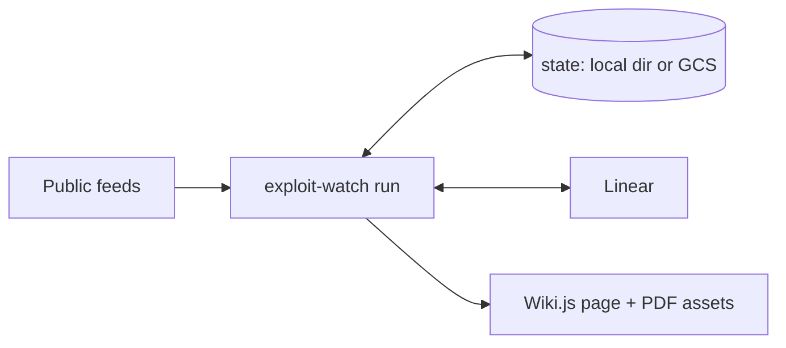

# Cyber Threat Dashboard

`exploit-watch` is a batch job that tracks public vulnerability feeds, matches them against a component list, files triage tickets in Linear and publishes a dashboard page on Wiki.js, with a monthly PDF report.

## What it does

- Pulls seven public feeds: CISA KEV, ENISA EUVD, CVE.org (cvelistV5), NVD (scores), GitHub Advisory Database, CERT-EU, NCSC-NL.
- Matches each new item against `components.sample.toml` (or your own list). Items that do not match are ruled out by rule.
- Files one Linear issue per matching item in the team's Triage inbox, then reads back the decision, owner, due date and status.
- Rewrites the tables of a Wiki.js page when the data changes, and at least once a day.
- Builds a PDF/A report with [typst](https://typst.app): month to date on every run, and a frozen monthly report on the first run of each month.

## How it works



One run:

1. Takes the state lock.
2. Fetches the feeds. If CISA KEV or CVE.org fails, the run stops; any other failing feed shows its last data, marked stale.
3. Matches items and files or reads back the Linear issues.
4. Builds the reports and closes the previous month if needed.
5. Writes the page.

## Quick start

Requires Docker with Compose v2.

```bash
cp .env.example .env
docker compose up -d --wait dev-wiki             # local Wiki.js on http://localhost:3000
docker compose run --rm job bootstrap            # admin, API key, page; writes .env
docker compose run --rm job run --dry-run        # fetch and diff; no writes to the wiki or Linear
docker compose up -d                             # job loop, every 6 hours
```

Services prefixed `dev-` exist for local development only:

- `dev-wiki` is a stock Wiki.js 2.x. To publish to another wiki, set `WIKI_BASE`, `WIKI_PAGE_ID` and `WIKIJS_API_KEY` in `.env`.
- `dev-report-serve` backs the page's "Generate current report" and "Sync with Linear" buttons. It has no authentication; its port is published on 127.0.0.1 only.

Linear is off by default (`LINEAR_MODE=off`). To file tickets, set `LINEAR_MODE=live`, `LINEAR_TEAM_ID`, and either `LINEAR_CLIENT_ID` + `LINEAR_CLIENT_SECRET` (OAuth app) or `LINEAR_API_KEY`. Use a separate `STATE_DIR` per Linear workspace.

## Usage

```text
exploit-watch run [--dry-run] [--out FILE] [--every SECONDS]
exploit-watch bootstrap [--reseed] [--update-css] [--skeleton FILE] [--css FILE]
exploit-watch report (--month YYYY-MM | --month-to-date) [--no-pdf]
exploit-watch report --close-month [--month YYYY-MM]
exploit-watch triage --report
exploit-watch demo OUT.html [--dark]
exploit-watch serve [--port 8090]
```

Run any subcommand with `--help` for its options. In the lab, prefix each command with `docker compose run --rm job`.

## Configuration

All settings are environment variables. [`.env.example`](.env.example) lists the common ones with their defaults; the full list is in the header of [`src/run.rs`](src/run.rs).

| Variable | Required | Purpose |
| --- | --- | --- |
| `WIKI_BASE`, `WIKI_PAGE_ID`, `WIKIJS_API_KEY` | yes | Target wiki and page; `bootstrap` writes the last two |
| `STATE_DIR`, `STATE_BUCKET` | — | Local state directory (default `./state`); with a GCS bucket it is the local mirror |
| `COMPONENTS_FILE` | — | Component list (default `components.sample.toml`) |
| `LINEAR_MODE`, `LINEAR_*` | — | Ticketing, see above |
| `EW_ENVIRONMENT` | — | `lab`, `test` or `production`; sets the data marking on the PDFs |
| `REPORT_ORG`, `REPORT_AUDIENCE`, `REPORT_TLP` | — | Report header, distribution line and TLP label |
| `NVD_API_KEY`, `GITHUB_TOKEN` | — | Higher API rate limits |

## Data sources and licences

| Feed | Terms |
| --- | --- |
| CISA KEV | CC0 1.0, via [cisagov/kev-data](https://github.com/cisagov/kev-data) |
| ENISA EUVD | Reuse allowed with the source acknowledged |
| CVE.org cvelistV5 | [CVE Terms of Use](https://www.cve.org/Legal/TermsOfUse); © The MITRE Corporation |
| NVD API | This product uses the NVD API but is not endorsed or certified by the NVD. |
| GitHub Advisory Database | [CC BY 4.0](https://creativecommons.org/licenses/by/4.0/) |
| CERT-EU | [CC BY 4.0](https://creativecommons.org/licenses/by/4.0/) |
| NCSC-NL | CC0 1.0 |

The page footer and the PDF appendix carry the full attribution. [`tests/fixtures/README.md`](tests/fixtures/README.md) lists where each test fixture comes from.

## Development

```text
src/                 the job (one binary)
page/                Wiki.js page content and CSS, built into the binary
tests/fixtures/      recorded and synthetic API responses
infra/gcp/           Terraform and deploy scripts
compose.yml          local dev stack
```

Build and test in Docker; no local Rust toolchain is needed:

```bash
docker run --rm \
  -e HTTP_PROXY -e HTTPS_PROXY \
  -v ew-target:/target -e CARGO_TARGET_DIR=/target \
  -v "$PWD:/src:ro" \
  -w /src \
  rust:1.99.1-slim-trixie \
  cargo test
```

In Git Bash on Windows, prefix the command with `MSYS_NO_PATHCONV=1`.

- The PDF tests are ignored by default. To run them, set `TYPST_BIN` to a typst 0.15.1 binary and run `cargo test -- --ignored report`.
- `infra/gcp/check.sh` runs `cargo deny` and the Terraform checks.
- After changing `page/`, rebuild the image (`docker compose build job`) and run `bootstrap --reseed --update-css`.

## Deployment

On Google Cloud the job runs as a Cloud Run Job, started every 6 hours by Cloud Scheduler, with its state in Cloud Storage. See [infra/gcp/README.md](infra/gcp/README.md).

## Security

- Secrets come only from the environment or Secret Manager; none are stored in the repository.
- Outbound requests to the feeds are HTTPS-only, size-capped, and follow redirects only within the same host (plus GitHub release downloads).
- Report a vulnerability privately to the repository maintainers, not in a public issue.
