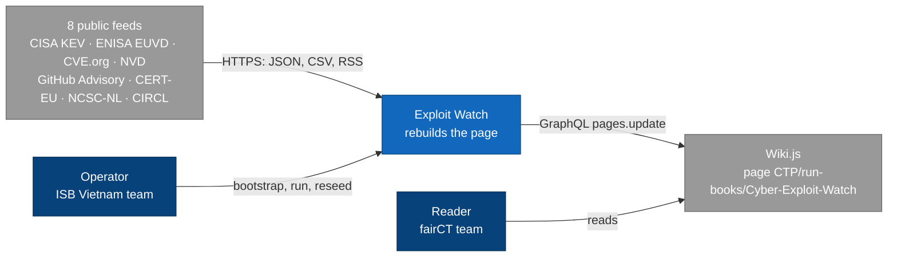
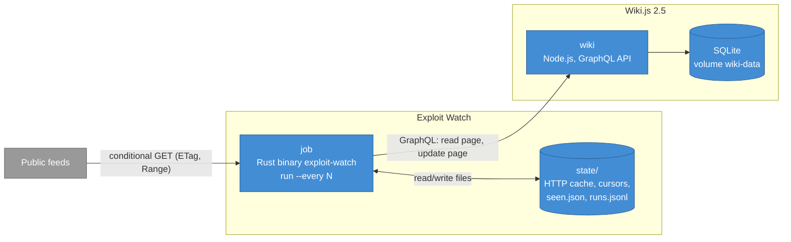
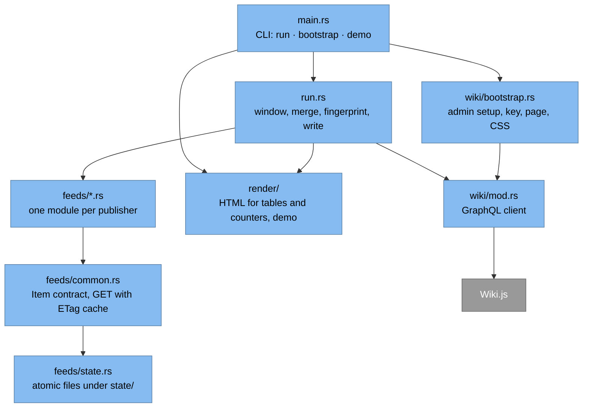

# Cyber Threat Exploit Watch

Rebuilds the Wiki.js page `CTP/run-books/Cyber-Exploit-Watch` from free public
vulnerability and advisory feeds, so the page always shows the last 7 days.

`Lab prototype` · `Local Docker Compose only` · `As of 2026-11-03`

## Contents

- [Overview](#overview)
- [Architecture](#architecture)
- [How a run works](#how-a-run-works)
- [Feeds](#feeds)
- [Getting started](#getting-started)
- [Operations](#operations)
- [Configuration](#configuration)
- [State](#state)
- [Development](#development)
- [Known limitations](#known-limitations)
- [Decisions](#decisions)
- [Roadmap](#roadmap)

## Overview

fairCT is the EU bond Consolidated Tape Provider built by Ediphy. Its DORA
milestone MS-30 ("Cyber threat dashboard") has one intake requirement, FR-A1:

> Ingest threat feeds from free, credible sources (CERT-EU, ENISA, CISA KEV,
> NCSC, NVD/CVE, MISP/CIRCL OSINT) into one dashboard. New items appear within
> 1 hour of publication; source and timestamp shown for each item.

This repository is a fork of Mark McKee's prototype `mckema/cyber-dashboard`
(2026-10-17), which refreshed the page weekly from three feeds with a Python
script. The fork:

- reads eight feeds (the FR-A1 sources plus GitHub Advisory);
- is a single Rust binary, `exploit-watch`;
- runs against a self-hosted Wiki.js 2.5 in Docker Compose for testing. The
  production page is on `wiki2.internal.ediphy.io` behind Google Cloud IAP and
  is not written by this fork yet.

The job only replaces content inside anchored elements of the page (table
bodies, counters, a stamp). Prose on the page stays hand-editable.

## Architecture

Diagrams follow the [C4 model](https://c4model.com). Level 4 (code) is not
drawn; [Deployment](#deployment) takes its place.



*Level 1, System Context.*



*Level 2, Container.*



*Level 3, Component (inside the job).*

### Deployment

| Environment | Runtime | Wiki | Status (2026-11-03) |
|---|---|---|---|
| Local lab | Docker Compose: `wiki` + `job`, loop every 1800 s | Wiki.js 2.5.317, page id 1 | Running |
| Production | Cloud Scheduler + Cloud Run Job, state in GCS | `wiki2.internal.ediphy.io` via IAP, page id 51 | Decided, not built |

## How a run works

1. Set the window to the last 7 days (UTC).
2. Call each feed module in order. A module whose `CADENCE` has not elapsed
   reuses the items of its last successful fetch (`state/items/`).
3. Merge: CISA KEV and ENISA EUVD rows join by CVE into one "exploited" table;
   NVD scores fill CVE.org records that have no CNA or CISA-ADP score;
   CERT-EU and NCSC-NL share one advisory table.
4. Render six tables (feed health, exploited, advisories, dependencies, CVEs,
   OSINT) and the counters, and splice them into the current page by anchor id.
5. Fingerprint the data, leaving out regions that change every run (health
   table, health count, window label). Write only when the fingerprint changed,
   when `HEARTBEAT_HOURS` has passed since the last write, or when the page no
   longer carries the current data (after a reseed or a manual edit).
6. Write with one `pages.update` call. `scriptCss` is never sent by the job.
7. Record each item's first-seen time in `seen.json` and one line in `runs.jsonl`.

| Condition | Result |
|---|---|
| CISA KEV or CVE.org cvelistV5 fails (the `CORE` feeds) | `FATAL`, nothing written, exit 1 |
| Any other feed fails after an earlier success | Last good items reused, health row "Stale", page written, exit 0 |
| Any other feed fails with no earlier success | Health row "Error", its table empty |
| A feed module panics | Treated as that feed failing (`internal error: panic: …`) |
| Every feed returns nothing | Refuses to publish, exit 1 |
| A page anchor is missing | `page anchor … not found — re-seed the page skeleton`, exit 1 |
| No data change, heartbeat not due | `skipping write`, no new page version |
| `FATAL` while looping (`--every`) | Logged and recorded as `fatal`; next run proceeds |

## Feeds

| Source | Endpoint and method | Cadence | Timestamp shown |
|---|---|---|---|
| CISA KEV | `cisa.gov` catalog; on failure the GitHub mirror `cisagov/kev-data` with `If-None-Match` | every run | date |
| ENISA EUVD | `/api/search?fromKEVDate&toKEVDate` (exploited entries only) | every run | date |
| CVE.org cvelistV5 | Range read of `deltaLog.json` (`Accept-Encoding: identity`), then each changed record; first run backfills from daily zips | every run | second, UTC |
| NVD API 2.0 | `lastModStartDate` from the cursor minus 15 min; scores only, merged into CVE.org rows | 2 h | — |
| GitHub Advisory | `type=reviewed`, `published=<date>..<date>`, follows `Link: rel="next"` | every run | second, UTC |
| CERT-EU | RSS every run; JSON per advisory only when new or changed | every run | second, UTC |
| NCSC-NL | `changes.csv` with ETag; CSAF document only when new or changed | every run | second, UTC |
| CIRCL OSINT | MISP `manifest.json` with ETag | every run | date |

Measured on 2026-11-03: a normal run makes about 10–40 requests, most answered
`304 Not Modified`. The first cvelistV5 backfill took 105 requests and 46.7 MB.

## Getting started

Requirements: Docker Desktop with Compose v2. No Rust toolchain is needed. Behind the corporate proxy, set `HTTP_PROXY` and
`HTTPS_PROXY` on the host; Compose passes them to the build and the job.

```bash
docker compose up -d --wait wiki
docker compose run --rm job bootstrap        # once: admin, API key, page; writes .env
docker compose run --rm job run --dry-run    # fetch and diff, write nothing
docker compose up -d                         # start the job loop
```

The page is at http://localhost:3000/en/CTP/run-books/Cyber-Exploit-Watch.
Run commands from the repository root (Git Bash on Windows).

## Operations

```bash
docker compose ps
docker compose logs -f job
docker compose run --rm job run                          # one run now
docker compose run --rm job run --out state/out.html     # render with live data, no write
docker compose run --rm job bootstrap --update-css       # after editing stack/wiki/page/style.css
docker compose run --rm job bootstrap --reseed --update-css && docker compose run --rm job run
                                                         # after editing stack/wiki/page/skeleton.html
docker compose run --rm job bootstrap --purge-history P7D   # drop page versions older than 7 days (all pages)
docker compose build job                                 # after any change under src/
tail -5 state/runs.jsonl
```

`bootstrap` is idempotent: a second run keeps the existing key
(`bootstrap ok (.env unchanged)`). After `docker compose down -v` the wiki's
admin and key are gone; run `bootstrap` again to recreate them.

## Configuration

Read from `.env` (created by `bootstrap` from `.env.example`) and the
environment. Compose overrides `WIKI_BASE` and `STATE_DIR` for the job.

| Variable | Default | Used for |
|---|---|---|
| `WIKI_BASE` | `https://wiki2.internal.ediphy.io` (compose: `http://wiki:3000`) | Wiki.js URL |
| `WIKI_PAGE_ID` | `51` (local bootstrap writes `1`) | Page to update |
| `WIKIJS_API_KEY` | — | Bot key, sent as `Authorization` |
| `IAP_ID_TOKEN` | — | Google OIDC token, sent as `Proxy-Authorization` (behind IAP only) |
| `WIKI_ADMIN_EMAIL`, `WIKI_ADMIN_PASSWORD` | `admin@example.com`, generated | Local admin, used by `bootstrap` only |
| `STATE_DIR` | `./state` | Job state |
| `INTERVAL_SECONDS` | `1800` | Seconds between runs in the compose loop |
| `HEARTBEAT_HOURS` | `6` | Rewrite the page after this long without a data change |
| `CVE_ROW_CAP` | `300` | Rows shown in the CVE table |
| `GITHUB_TOKEN` | — | Raises the GitHub API limit from 60 to 5,000 requests/h |
| `NVD_API_KEY` | — | Removes the 6 s pause between NVD pages |
| `USER_AGENT` | built-in | User-Agent for feed requests; CERT-EU rejects requests without one |

Do not put `$` or quotes in `.env` values: Compose reads the file too.

## State

`state/` is gitignored, owned by uid 1000 (the job's user), and was about
16 MB on 2026-11-03.

| Path | Content |
|---|---|
| `http/` | Conditional-GET cache: ETag and body of the last `200` |
| `items/<module>.json` | Items of each feed's last successful fetch |
| `cursors/` | Per-feed cursors: cvelistV5 `fetchTime`, NVD and CVE stores, CERT-EU and NCSC-NL caches |
| `seen.json` | Item key → first-seen time, kept 30 days |
| `wiki.json` | Data fingerprint and time of the last write |
| `runs.jsonl` | One line per run: `result` (`written`, `unchanged`, `would-write`, `out`, `fatal`, `crash`), per-feed `status`, `items`, `new`, `lag_max_min`, `over_sla` |

Reset only what you need: deleting `http/` forces full downloads; deleting
`cursors/cvelist*` forces a 7-day backfill (about 47 MB); deleting `seen.json`
makes the next run a baseline with no lag measured. If a root container
created files in `state/`, the job cannot write them; fix with
`MSYS_NO_PATHCONV=1 docker run --rm -v "$(pwd -W):/app" debian:bookworm-slim chown -R 1000:1000 /app/state`.

## Development

```
compose.yml                 both services: wiki (Wiki.js 2.x) and job
stack/wiki/page/            skeleton.html (page content with anchor ids), style.css (scriptCss)
stack/job/Dockerfile        build on rust:1.99.1-slim-bookworm, run on debian:bookworm-slim as uid 1000
stack/job/Dockerfile.dockerignore   build context: Cargo.toml, Cargo.lock, src/ only
src/                        crate exploit-watch (Rust 1.99, edition 2024)
tests/fixtures/             trimmed real payloads for unit tests and demo
```

Unit tests run in a container and make no network calls. Add a test name to
run one test; add `-- --ignored` for the tests that call the live feeds.

```bash
MSYS_NO_PATHCONV=1 docker run --rm -e HTTP_PROXY=$HTTP_PROXY -e HTTPS_PROXY=$HTTPS_PROXY \
  -v cargo-registry:/usr/local/cargo/registry -v ew-target:/target -e CARGO_TARGET_DIR=/target \
  -v "$(pwd -W):/src" -w /src rust:1.99.1-slim-bookworm cargo test --quiet
```

`exploit-watch demo OUT.html [--dark]` renders the page from
`tests/fixtures/render_items.json` for visual review.

To add a feed, write a module in `src/feeds/` that follows the contract at the
top of `src/feeds/common.rs` (`NAME`, `TABLE`, `CADENCE`, `fetch(start, end)`
returning all items or an error, never a partial list) and list it in
`feeds::all()`. Page markup must not use inline `style` attributes; all styling
goes in `stack/wiki/page/style.css` (see [Known limitations](#known-limitations)).

## Known limitations

Found by testing against Wiki.js 2.5.317 and the live feeds on 2026-11-03.

**Wiki.js**

- The HTML sanitiser strips `<style>`, `<script>` and `<link>` and mangles long
  inline `style` attributes, so the page has no JavaScript and no inline styles.
- `pages.single` checks `manage:pages`, not `read:pages`. The bot key's group has
  `read:pages`/`write:pages` on `CTP/run-books/` and `manage:pages` on this page only.
- A wrong key does not return 401: an unknown key reads as guest (HTTP 200,
  "not authorized"); a revoked key or a disabled API returns HTTP 500.
- An admin `pages.update` without `scriptCss` clears the page CSS; `bootstrap`
  always resends it. The bot key has no `write:styles`, so job writes keep it.
- Every update creates a page version (about 330 KB each). Old versions are
  removed only by `bootstrap --purge-history`, as admin.
- `pages.create` reports a misleading "not authorized to delete" message on
  refusal; only its error code is reliable.
- Behind the corporate proxy the local wiki cannot fetch its locale files, so
  its chrome shows raw keys such as `header.search`. The page is not affected.

**Feeds**

- `cisa.gov` returns 403 through the corporate proxy; KEV is read from the
  GitHub mirror, which trailed catalog releases by 1.1–4.4 h (8 releases,
  2026-10-21..30).
- NVD scores few new CVEs: a severity filter returned 156 of 3,371 CVEs over
  7 days. NVD is used for scores only.
- The GitHub API allows 60 unauthenticated requests per hour per IP, shared by
  everyone behind the proxy; `304` responses still count.
- CERT-EU's RSS dates carry a "CEST" label; the job uses the per-advisory JSON
  time (UTC). Whether the label changes to "CET" in winter is not verified.
- Some NCSC-NL documents have only a CVSS 4.0 vector in a note; those items show
  no score. NCSC-NL titles are in Dutch.
- CIRCL OSINT has had no new event since 2026-08-13.
- The CVE table shows the first 300 rows by score (`CVE_ROW_CAP`).
- Items with a date only (KEV, EUVD, CIRCL) have no measurable lag.

## Decisions

| Date | Decision | By | Status |
|---|---|---|---|
| 2026-11-03 | Build FR-A1 on the prototype: fork, all FR-A1 sources, self-hosted Wiki.js for testing | ISB Vietnam team lead | Decided |
| 2026-11-03 | "NCSC" in FR-A1 means NCSC-NL | Mark McKee | Decided |
| 2026-11-03 | Run every 6 hours instead of every 30 minutes | Mark McKee | Decided, not yet applied |
| 2026-11-03 | Drop CIRCL OSINT | Mark McKee | Decided, not yet applied |
| 2026-11-03 | Accept the KEV GitHub mirror as fallback until `cisa.gov` is rechecked from GCP | Mark McKee | Decided |
| 2026-11-03 | "Within 1 hour" is not a hard rule; measure lag from first publication only | Mark McKee | Decided, not yet applied |
| 2026-11-03 | FR-A2: items matching no fairCT component are marked not relevant by rule; rule name and version recorded as triager | Mark McKee | Decided, not built |
| 2026-11-03 | Component list: a small test list (Rust or UI libraries) for now; final list to be agreed with Germano | Mark McKee | Decided |
| 2026-11-03 | FR-A9: a Linear ticket is sufficient for now | Mark McKee | Decided |
| 2026-11-03 | Production runtime: Cloud Scheduler + Cloud Run Job | Mark McKee | Decided, deferred until the local workflow is verified |
| 2026-11-03 | Do not create the prototype's GitHub Actions workflow for now | ISB Vietnam team | Decided |

## Roadmap

| Item | Requirement | Status (2026-11-03) |
|---|---|---|
| Apply the 6-hour cadence, drop CIRCL, lag from first publication | FR-A1 | Next |
| Match items against a component list; mark non-matches by rule | FR-A2 | Planned |
| One Linear issue per matched item in the Triage inbox; untriaged and open-ticket tables on the page | FR-A2, FR-A3, FR-A9 | Planned (local, fake tracker first) |
| Monthly and on-demand report to the fairCT COO | FR-A4 | Not started |
| Cloud Run Job, Cloud Scheduler, GCS state, Terraform; write to `wiki2` via IAP | — | Deferred |
