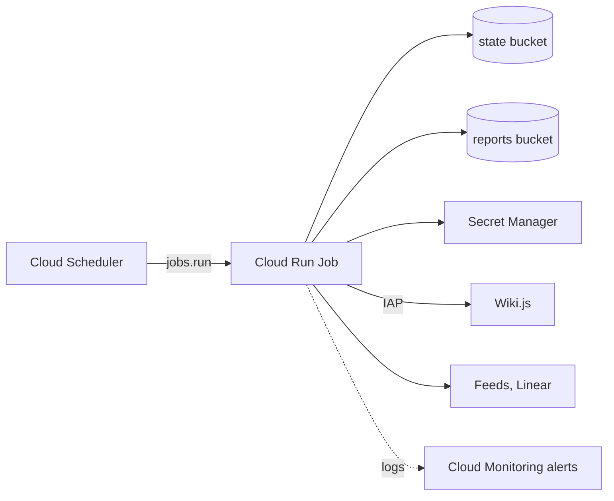

# Deploying to Google Cloud

The job runs as one Cloud Run Job (~ECS task on Fargate), which Cloud Scheduler (~EventBridge Scheduler) starts every 6 hours. Its state lives in Cloud Storage (~S3), under a lease lock. The first run of each month also closes the previous month and copies the frozen report to a separate reports bucket.



## Layout

```text
bootstrap.sh         once per project: required APIs and the Terraform state bucket
build-push.sh        build the image, push it to Artifact Registry, print its digest
check.sh             offline checks: terraform fmt/validate, tflint, checkov, cargo deny
terraform/modules/exploit-watch/   all resources, one file per concern
terraform/envs/<env>/              thin root: backend, provider, terraform.tfvars
```

## Resources

| Resource | Notes |
| --- | --- |
| Cloud Run Job `exploit-watch-<env>` | Image by digest; 1 vCPU, 1 GiB, 30 min timeout, no retry |
| Cloud Scheduler `exploit-watch-trigger-<env>` | `0 */6 * * *` in the configured time zone |
| Artifact Registry `exploit-watch` (~ECR) | Immutable tags, vulnerability scanning, cleanup policy |
| Buckets `exploit-watch-state-<env>`, `exploit-watch-reports-<env>` | Uniform access, public access prevention; the state bucket is versioned; the reports bucket has a retention period and optional Bucket Lock (~S3 Object Lock) |
| Secret Manager (~AWS Secrets Manager) | Wiki.js API key and Linear OAuth client (required: the deployed job always runs with Linear on); GitHub and NVD keys via `optional_secrets`. Terraform creates the secrets, values are added by hand |
| Service accounts `exploit-watch-bot-<env>`, `exploit-watch-sched-<env>` | No keys and no project-level roles |
| Alerts | No successful run for 7 h; 2 failed executions in 13 h; a run with tracker, report or close errors. Sent to `alert_emails` (empty: no one is notified) |
| Optional | Cloud NAT (~NAT Gateway) with a static IP (`enable_nat`), CMEK (`enable_cmek`), budget (`billing_account_id`) |

The wiki's owner grants `roles/iap.httpsResourceAccessor` to the bot service account. Terraform does not manage that binding.

## Deploy

Requires `gcloud`, `git`, Docker, and Terraform 1.16. Run from the repo root. Only `envs/sandbox` exists; for another environment, copy it.

Before you start, the target wiki needs the page, the bot group and its API key. Run `exploit-watch bootstrap` against it (admin credentials, `WIKI_BASE`, and `IAP_ID_TOKEN` if the wiki is behind IAP), or have the wiki owner create them.

```bash
gcloud auth login
gcloud auth application-default login
infra/gcp/bootstrap.sh --project <project_id> --env sandbox    # prints the state bucket
cd infra/gcp/terraform/envs/sandbox
# fill terraform.tfvars (every TODO-, alert_emails), keep image_digest = null
terraform init -backend-config="bucket=<state bucket>"
terraform apply                                  # phase 1: everything but the job

# for each id in `terraform output secret_ids`:
printf '%s' "$VALUE" | gcloud secrets versions add <secret_id> --data-file=- --project <project_id>

cd -
infra/gcp/build-push.sh --project <project_id> --region <region>   # prints <image>@sha256:...
# set image_digest in terraform.tfvars to that value
terraform -chdir=infra/gcp/terraform/envs/sandbox apply   # phase 2: job, trigger, alerts
# the wiki owner grants roles/iap.httpsResourceAccessor to: terraform output bot_service_account_email
gcloud run jobs execute exploit-watch-sandbox --region <region> --wait
```

- Configuration reaches the job as environment variables. The environment root exposes the settings you can put in `terraform.tfvars` (`envs/<env>/variables.tf`); to set any other input of the module (`modules/exploit-watch/variables.tf`), add it to the root first.
- Secrets are referenced from Secret Manager and never enter the Terraform state.
- `lock_retention = true` locks the reports bucket permanently. Set it only once the retention period is final.

## Checks

```bash
infra/gcp/check.sh
```

Runs in Docker with no cloud credentials. It needs network access to pull images, providers and the RustSec database. Tool images are pinned by digest; skipped Checkov rules carry their reason inline.
